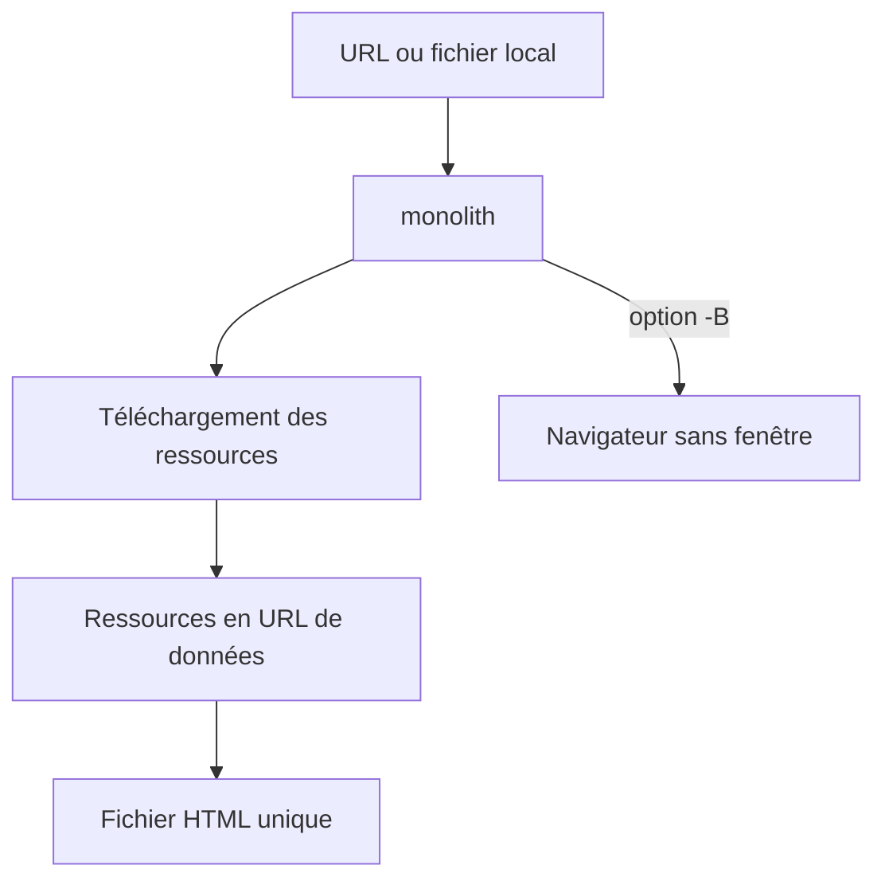

# Y2Z/monolith

> Command-line tool that saves a web page into a single self-contained HTML file.

## The problem
"Save as" does not keep everything, and `wget -mpk` leaves scattered files that do not display offline.

## What it actually does
Fetches a page and embeds CSS, images and JavaScript as data URLs, producing a single HTML5 document. Options to strip images, scripts or fonts, filter domains, read an MHTML file, extract reader mode (`-R`). The `-B` option first has the page rendered by a Firefox or Chromium browser. Also available as a Rust library.

## How it is wired
Simplified diagram based on the fiche, no diagram provided.


## Trying it
```bash
cargo install monolith
monolith https://lyrics.github.io/db/P/Portishead/Dummy/Roads/ -o %title%.%timestamp%.html
monolith -B https://example.com -o example.html
```

## Cost and gotchas
Free. Installable via Cargo, Homebrew, Docker and many other package managers (so the deployment field is approximate). The `-B` mode requires an installed browser. A saved page only contains what it loaded during the capture.

## What it is not
It is not a scraping engine with its own JavaScript engine: without `-B`, dynamic content is not rendered. Parts of a web app that were never opened are not captured.

## Alternatives
- `wget -mpk`: cited by the README, but it leaves separate files and the offline rendering is less faithful.

## For you
Adopt: archive articles, docs and leaderboard pages as one file per page, handy for watch work and text corpora.
