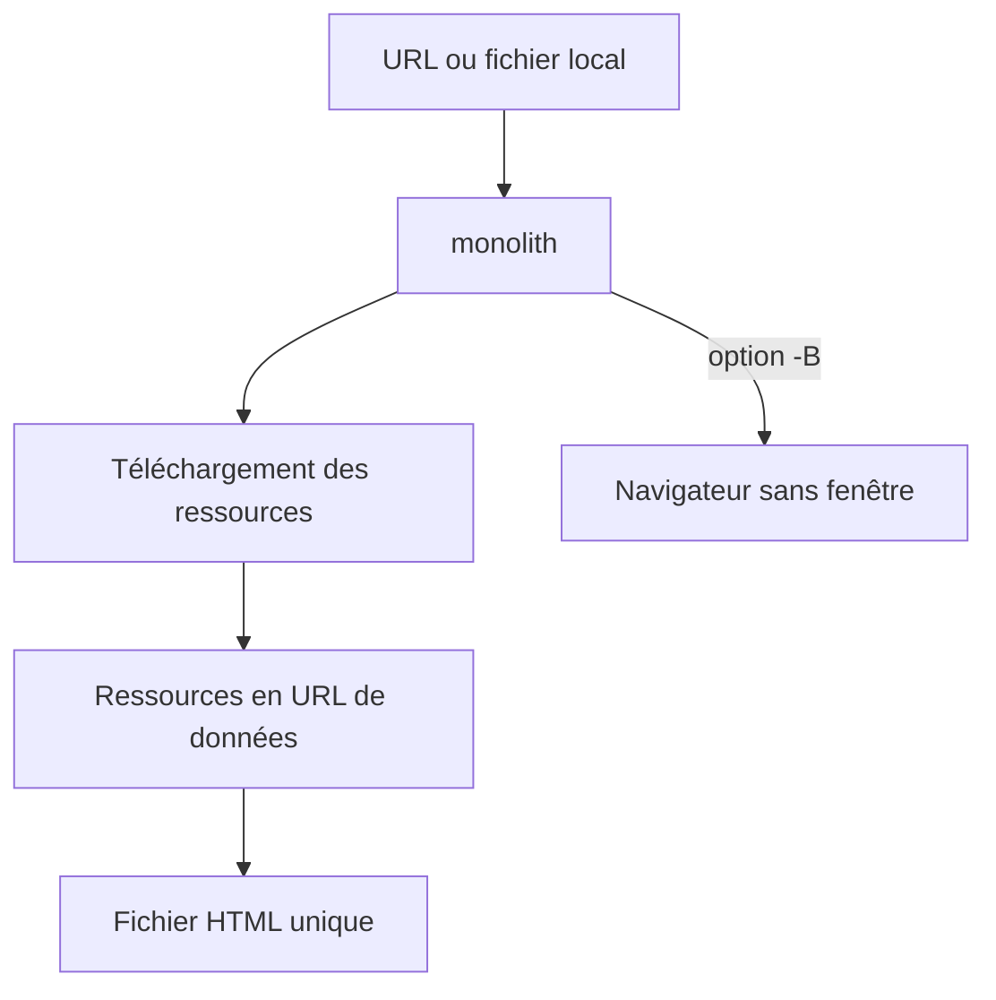

# Y2Z/monolith

> Outil en ligne de commande qui enregistre une page web dans un seul fichier HTML autonome.

## Le problème
« Enregistrer sous » ne garde pas tout, et `wget -mpk` laisse des fichiers dispersés qui ne s'affichent pas hors ligne.

## Ce que ça fait vraiment
Récupère une page et incorpore CSS, images et JavaScript en URL de données, pour obtenir un unique document HTML5. Options pour retirer images, scripts ou polices, filtrer des domaines, lire un MHTML, extraire le mode lecture (`-R`). L'option `-B` fait d'abord rendre la page par un navigateur Firefox ou Chromium. Existe aussi comme bibliothèque Rust.

## Comment c'est branché
Schéma simplifié d'après la fiche, sans diagramme fourni.


## Essayer
```bash
cargo install monolith
monolith https://lyrics.github.io/db/P/Portishead/Dummy/Roads/ -o %title%.%timestamp%.html
monolith -B https://example.com -o example.html
```

## Coût et pièges
Gratuit. Installation via Cargo, Homebrew, Docker et beaucoup d'autres gestionnaires (donc le champ de déploiement est approximatif). Le mode `-B` exige un navigateur installé. Une page sauvegardée ne contient que ce qu'elle a chargé pendant l'enregistrement.

## Ce que ce n'est pas
Ce n'est pas un moteur de scraping avec moteur JavaScript propre : sans `-B`, le contenu dynamique n'est pas rendu. Les parties d'une appli web jamais ouvertes ne sont pas capturées.

## Alternatives
- `wget -mpk` : cité par le README, mais il laisse des fichiers séparés et le rendu hors ligne est moins fidèle.

## Pour toi
À adopter : archiver des articles, des docs et des pages de leaderboards en un fichier par page, pratique pour la veille et les corpus de texte.

