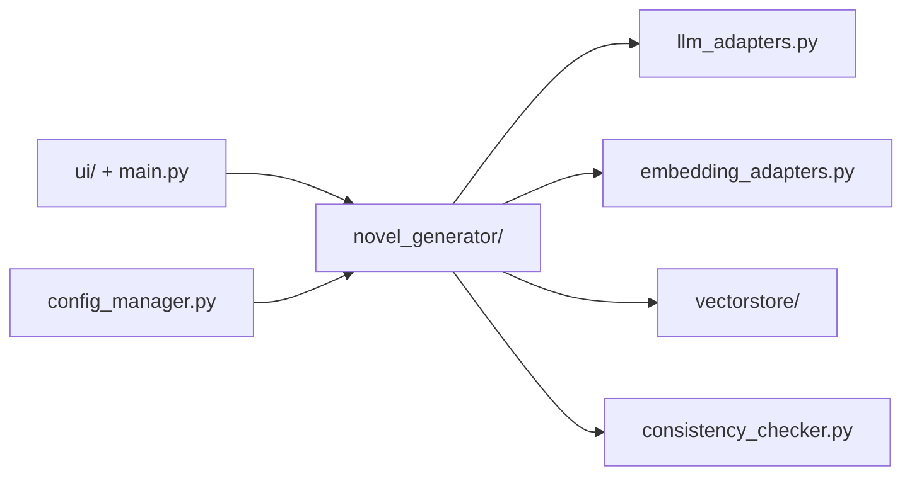

# YILING0013/AI_NovelGenerator

> Desktop application that generates long novels with an LLM, keeping the story consistent and remembered.

## The problem
An LLM alone loses the thread over a long text: characters, plots and clues are forgotten.

## What it actually does
Graphical interface in four steps: world settings, chapter outline, draft, finalization. For each chapter, it rereads the global summary, the state of characters and arcs, queries a vector store and updates those files. Optional contradiction check. LLM and embedding adapters (OpenAI, DeepSeek, Gemini, Ollama), configurable per task.

## How it is wired


## Trying it
```bash
git clone https://github.com/YILING0013/AI_NovelGenerator
cd AI_NovelGenerator
pip install -r requirements.txt
python main.py
pip install pyinstaller
pyinstaller main.spec
```

## Cost and gotchas
API keys and token consumption are at your expense (or Ollama locally). A C++ compiler is sometimes required on Windows. The author says there is little maintenance time and a rewrite in a `dev` branch.

## What it is not
Not a guarantee of literary quality; consistency still needs to be proofread. AGPL-3.0.

## Alternatives
None named in the README.

## For you
Watch as an example of long memory (summaries, state, RAG) around an LLM; unstable project awaiting a rewrite.
