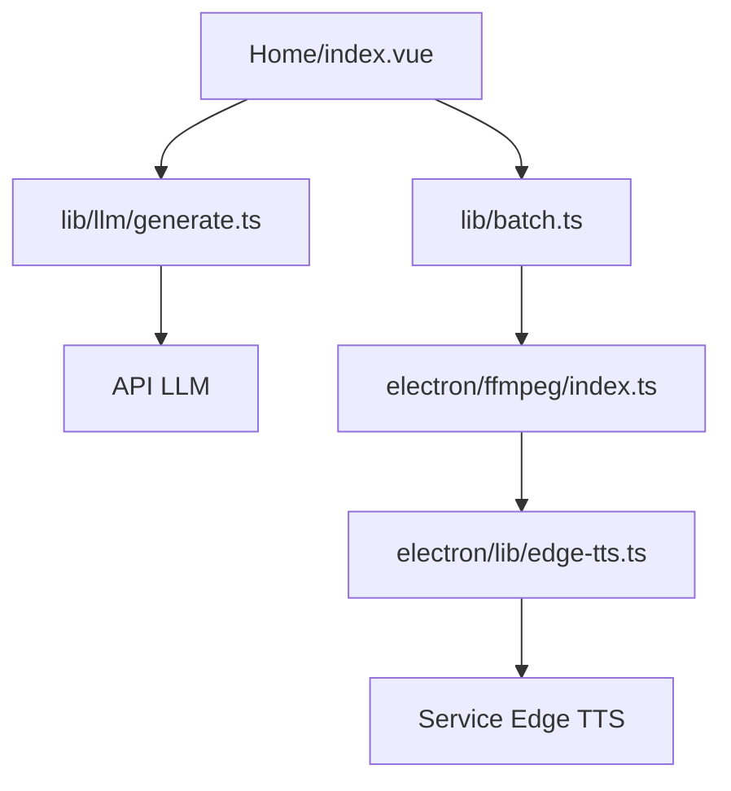

# YILS-LIN/short-video-factory

> Desktop application that generates short marketing videos from a prompt and video shots.

## The problem
Manually editing dozens of short videos (text, voice, subtitles) takes a considerable amount of time.

## What it actually does
Electron application: an OpenAI-compatible LLM writes the text, Edge TTS voices it, FFmpeg assembles video, audio and subtitles. A batch mode chains tasks according to presets. Interface mostly in Chinese, also in English.

## How it is wired


## Trying it
```bash
# Aucune commande dans le README : télécharger la dernière version sur
# la page Releases de GitHub.
```

## Cost and gotchas
LLM API key at your expense. Voice goes through the Edge TTS cloud service. The architecture shows an analytics service, whereas the README speaks of "entirely local" execution: to be verified.

## What it is not
Not entirely local despite the README. Subtitle effects, more voices and more parameters are still to be done (roadmap).

## Alternatives
No alternative named in the README (edge-tts is cited as a building block).

## For you
Ignore: marketing video production, outside your scope, with AGPL and cloud calls.
