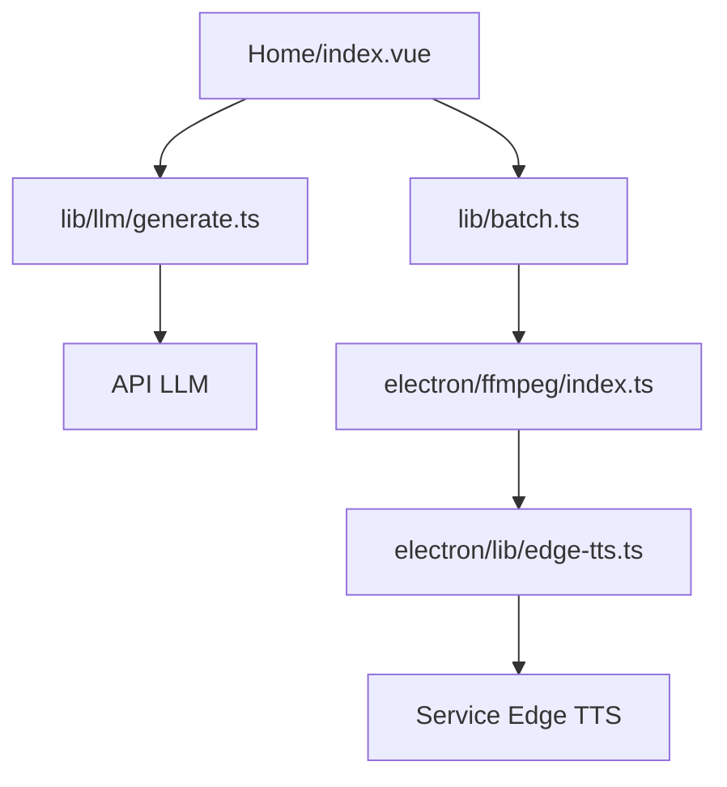

# YILS-LIN/short-video-factory

> Application de bureau qui génère des vidéos courtes marketing à partir d'un prompt et de plans vidéo.

## Le problème
Monter à la main des dizaines de vidéos courtes (texte, voix, sous-titres) prend un temps considérable.

## Ce que ça fait vraiment
Application Electron : un LLM compatible OpenAI écrit le texte, Edge TTS le met en voix, FFmpeg monte vidéo, audio et sous-titres. Un mode batch enchaîne des tâches selon des préréglages. Interface surtout en chinois, aussi en anglais.

## Comment c'est branché


## Essayer
```bash
# Aucune commande dans le README : télécharger la dernière version sur
# la page Releases de GitHub.
```

## Coût et pièges
Clé d'API LLM à ta charge. La voix passe par le service cloud Edge TTS. L'architecture montre un service d'analytics, alors que le README parle d'exécution « entièrement locale » : à vérifier.

## Ce que ce n'est pas
Pas entièrement local malgré le README. Les effets de sous-titres, plus de voix et plus de paramètres sont encore à faire (feuille de route).

## Alternatives
Aucune alternative nommée dans le README (edge-tts est cité comme brique).

## Pour toi
À ignorer : production de vidéos marketing, hors de ton périmètre, avec AGPL et appels cloud.

