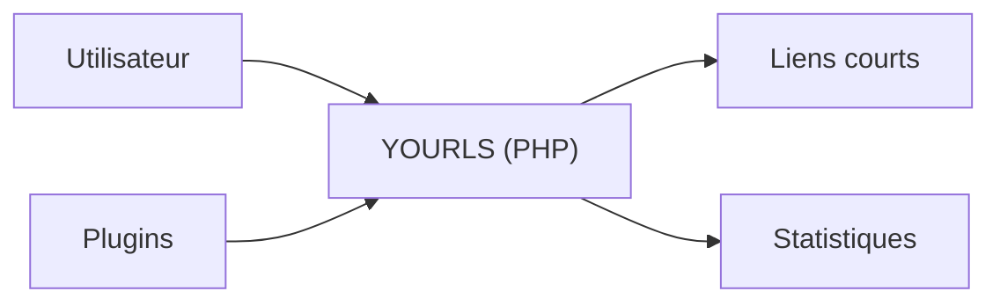

# YOURLS/YOURLS

> PHP scripts to host your own URL shortener with statistics, plugins and control over your data.

## The problem
Online URL shorteners keep your links and their statistics with a third party.

## What it actually does
Minimal sheet: the README is under 800 characters. It describes a set of PHP scripts to install on your own server, with "total data control, detailed statistics, analytics, plugins". Installation and configuration are not described: the README points to docs.yourls.org.

## How it is wired
Not documented; diagram limited to what the README states.

## Trying it
No command documented: see docs.yourls.org.

## Cost and gotchas
Free, MIT. A PHP server is on you; prerequisites and database are not specified in the README.

## What it is not
Not a hosted service: you have to install it yourself. Nothing in the README about authentication or public exposure.

## Alternatives
None named in the README.

## For you
Ignore: self-hosted URL shortener, unrelated to data/AI work, and with no technical substance in the README.
