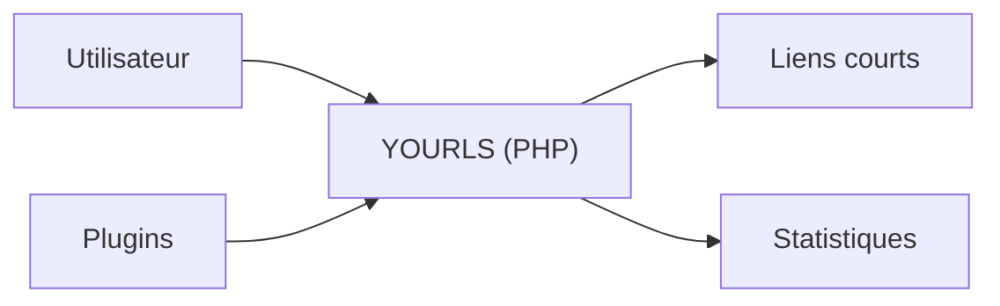

# YOURLS/YOURLS

> Scripts PHP pour héberger son propre raccourcisseur d'URL avec statistiques, plugins et contrôle des données.

## Le problème
Les raccourcisseurs d'URL en ligne gardent tes liens et leurs statistiques chez un tiers.

## Ce que ça fait vraiment
Fiche minimale : le README fait moins de 800 caractères. Il décrit un ensemble de scripts PHP à installer sur son serveur, avec « contrôle total des données, statistiques détaillées, analyses, plugins ». L'installation et la configuration ne sont pas décrites : le README renvoie à docs.yourls.org.

## Comment c'est branché
Non documenté ; schéma limité à ce que le README énonce.

## Essayer
Aucune commande documentée : voir docs.yourls.org.

## Coût et pièges
Gratuit, MIT. Un serveur PHP à ta charge ; prérequis et base de données non précisés dans le README.

## Ce que ce n'est pas
Pas un service hébergé : il faut l'installer soi-même. Rien dans le README sur l'authentification ou l'exposition publique.

## Alternatives
Aucune nommée dans le README.

## Pour toi
Ignorer : raccourcisseur d'URL auto-hébergé, sans rapport avec le travail data/IA, et sans matière technique dans le README.

