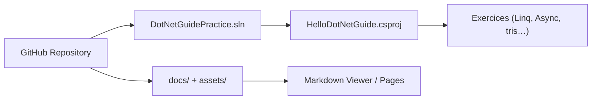

# YSGStudyHards/DotNetGuide

> Chinese-language guide to C#/.NET resources: learning paths, books, tutorials, tools, interviews.

## The problem
Quality C#/.NET resources are scattered across QQ, WeChat and Zhihu, hard for a beginner to find.

## What it actually does
Curated list of Chinese-language links: learning paths, videos, books, projects, tools (Visual Studio, VS Code), tutorials (MongoDB, SQLite, Blazor, NPOI, WinDbg debugging), databases, Docker, Git, CV templates and interview topics. A small console project `HelloDotNetGuide` contains runnable exercises.

## How it is wired

## Trying it
No command in the README; the code is run with the .NET SDK from the `DotNetGuidePractice.sln` solution.

## Cost and gotchas
Free. Content in Chinese; some of the resources point to a WeChat account or third-party services.

## What it is not
Not a structured course: an index of links, of uneven and unverified quality.

## Alternatives
No alternative named, apart from the Awesome .NET lists cited.

## For you
Ignore: it is .NET in Chinese, outside your data/AI core.
