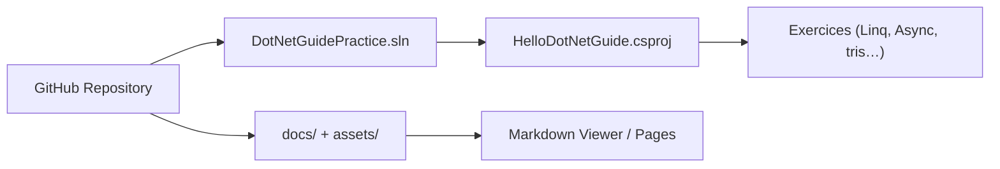

# YSGStudyHards/DotNetGuide

> Guide en chinois de ressources C#/.NET : parcours, livres, tutoriels, outils, entretiens.

## Le problème
Les ressources C#/.NET de qualité sont dispersées entre QQ, WeChat et Zhihu, difficiles à trouver pour un débutant.

## Ce que ça fait vraiment
Liste curée de liens en chinois : parcours d'apprentissage, vidéos, livres, projets, outils (Visual Studio, VS Code), tutoriels (MongoDB, SQLite, Blazor, NPOI, débogage WinDbg), bases de données, Docker, Git, modèles de CV et sujets d'entretien. Un petit projet console `HelloDotNetGuide` contient des exercices exécutables.

## Comment c'est branché

## Essayer
Aucune commande dans le README ; le code se lance avec le SDK .NET depuis la solution `DotNetGuidePractice.sln`.

## Coût et pièges
Gratuit. Contenu en chinois ; une partie des ressources renvoie à un compte WeChat ou à des services tiers.

## Ce que ce n'est pas
Pas un cours structuré : un index de liens, de qualité inégale et non vérifiée.

## Alternatives
Aucune alternative nommée, hors listes Awesome .NET citées.

## Pour toi
À ignorer : c'est du .NET en chinois, hors de ton cœur data/IA.

