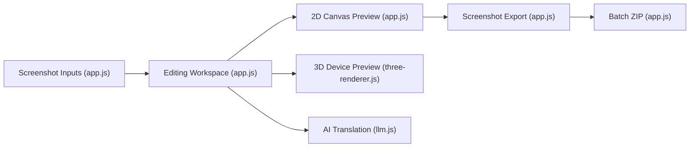

# YUZU-Hub/appscreen

> Free web editor to build App Store screenshots with backgrounds, text and 3D mockups.

## The problem
Producing by hand the visuals at the right sizes (iPhone, iPad) for a mobile app's store listing.

## What it actually does
- Loads screenshots, picks the output size, customizes background (gradient, color, image), text and device (2D or 3D iPhone).
- Single export or global ZIP.
- Optional AI translation of titles (Claude, OpenAI or Google) with a key entered by the user, stored in the browser.
- Plain JavaScript, Canvas, Three.js, IndexedDB.

## How it is wired


## Trying it
```bash
python3 -m http.server 8000
npx serve .
docker run -d -p 8080:80 ghcr.io/yuzu-hub/appscreen:latest
```
Or use the version hosted on GitHub Pages directly.

## Cost and gotchas
Free; AI translation consumes your API key. Data is stored in the browser's IndexedDB. 3D models are under CC BY 4.0 (attribution).

## What it is not
Not an automatic screenshot generator: you must supply your own images. No license declared in the repository, so the code's reuse rights are uncertain.

## Alternatives
No alternative named in the README.

## For you
Ignore: mobile marketing utility, outside the data/AI scope, and without a clear license.
