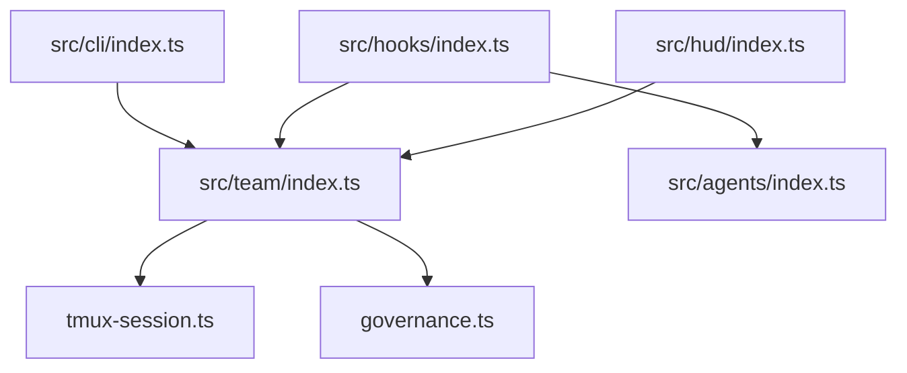

# Yeachan-Heo/oh-my-claudecode

> A multi-agent orchestration plugin for Claude Code, with an `omc` CLI and ready-to-use skills.

## The problem
Coordinating several agents, verification loops and session state in Claude Code requires a lot of manual configuration.

## What it actually does
Installs hooks, skills and an MCP server. Modes `/team` (plan, PRD, execution, verification, fixing), `/autopilot`, `/ralph`, `/deep-interview`. `omc team` launches tmux workers (Codex, Gemini, Cursor, Claude). Status HUD, skills extracted from sessions, Slack/Discord/Telegram notifications.

## How it is wired


## Trying it
```bash
/plugin marketplace add https://github.com/Yeachan-Heo/oh-my-claudecode
/plugin install oh-my-claudecode
/omc-setup
/autopilot "build a REST API for managing tasks"
```
CLI variant: `npm i -g oh-my-claude-sisyphus@latest`.

## Cost and gotchas
Consumes your Claude tokens (API key or subscription) and those of the third-party CLIs. The npm name differs from the repo name. Writes local state under `.omc/`. The README provided is truncated.

## What it is not
Not a tool independent of Claude Code. The "30 to 50% fewer tokens" gains come from the README and are unverified.

## Alternatives
`gajae-code` (simpler, according to the README) and `oh-my-codex` (for Codex CLI).

## For you
Worth watching: interesting if you already orchestrate Claude agents, but costly in tokens and fast-moving.
