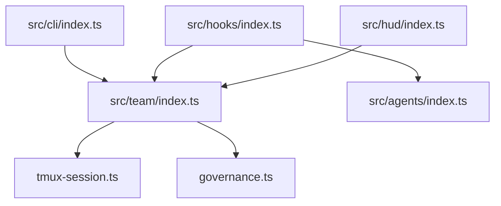

# Yeachan-Heo/oh-my-claudecode

> Plugin d'orchestration multi-agents pour Claude Code, avec CLI `omc` et compétences prêtes à l'emploi.

## Le problème
Coordonner plusieurs agents, boucles de vérification et état de session dans Claude Code demande beaucoup de configuration manuelle.

## Ce que ça fait vraiment
Installe hooks, compétences et serveur MCP. Modes `/team` (plan, PRD, exécution, vérification, correction), `/autopilot`, `/ralph`, `/deep-interview`. `omc team` lance des workers tmux (Codex, Gemini, Cursor, Claude). HUD de statut, compétences extraites des sessions, notifications Slack/Discord/Telegram.

## Comment c'est branché


## Essayer
```bash
/plugin marketplace add https://github.com/Yeachan-Heo/oh-my-claudecode
/plugin install oh-my-claudecode
/omc-setup
/autopilot "build a REST API for managing tasks"
```
Variante CLI : `npm i -g oh-my-claude-sisyphus@latest`.

## Coût et pièges
Consomme tes tokens Claude (clé d'API ou abonnement) et ceux des CLI tierces. Le nom npm diffère du nom du dépôt. Écrit un état local sous `.omc/`. Le README fourni est tronqué.

## Ce que ce n'est pas
Pas un outil indépendant de Claude Code. Les gains « 30 à 50 % de tokens » viennent du README, non vérifiés.

## Alternatives
`gajae-code` (plus simple, selon le README) et `oh-my-codex` (pour Codex CLI).

## Pour toi
À surveiller : intéressant si tu orchestres déjà des agents Claude, mais coûteux en tokens et très évolutif.

