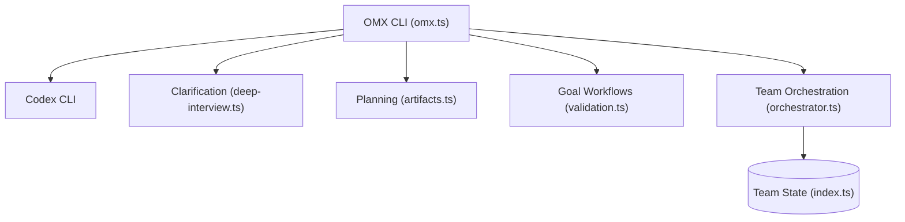

# Yeachan-Heo/oh-my-codex

> Workflow and execution layer on top of the OpenAI Codex CLI, with planning, durable goals and agent teams.

## The problem
Codex alone enforces neither requirements clarification, nor an approved plan, nor state tracking on long tasks.

## What it actually does
`omx` launches Codex with a `$deep-interview`, `$ralplan`, `$ultragoal` sequence, plus `$team` for parallel work under tmux and git worktrees. State (plans, logs, memory) is kept in `.omx/`. Diagnostic, export and session usage commands, a mission queue, a `--madmax` mode that removes approvals and the sandbox.

## How it is wired


## Trying it
```bash
codex --version
npm install -g oh-my-codex
omx doctor
omx exec --skip-git-repo-check -C . "Reply with exactly OMX-EXEC-OK"
omx --worktree=feat/task --madmax --xhigh
```

## Cost and gotchas
Codex CLI installed and authenticated, Node.js 20+, tmux recommended. Model calls are at your expense. Native Windows and the Codex app are poorly supported. The README is truncated in the material provided.

## What it is not
Not a replacement for Codex: it remains the engine. `--madmax` removes the safeguards: reserve it for trusted repositories, preferably in a worktree. Forks named "OMX v2" are not official.

## Alternatives
- gajae-code: lighter version, cited in the README for those who find OMX excessive.

## For you
Interesting if you already work with Codex and want planning and tracking discipline, but young, centered on one person and dependent on OpenAI: worth watching.
