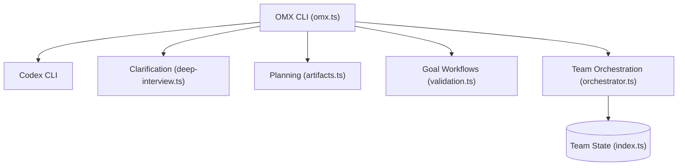

# Yeachan-Heo/oh-my-codex

> Couche de workflows et d'exécution au-dessus du CLI OpenAI Codex, avec planification, objectifs durables et équipes d'agents.

## Le problème
Codex seul n'impose ni clarification des besoins, ni plan approuvé, ni suivi d'état sur les longues tâches.

## Ce que ça fait vraiment
`omx` lance Codex avec un enchaînement `$deep-interview`, `$ralplan`, `$ultragoal`, plus `$team` pour le travail parallèle sous tmux et git worktrees. L'état (plans, journaux, mémoire) est gardé dans `.omx/`. Commandes de diagnostic, export et usage des sessions, file de missions, mode `--madmax` qui supprime approbations et bac à sable.

## Comment c'est branché


## Essayer
```bash
codex --version
npm install -g oh-my-codex
omx doctor
omx exec --skip-git-repo-check -C . "Reply with exactly OMX-EXEC-OK"
omx --worktree=feat/task --madmax --xhigh
```

## Coût et pièges
Codex CLI installé et authentifié, Node.js 20+, tmux conseillé. Les appels de modèle sont à ta charge. Windows natif et l'application Codex sont peu supportés. Le README est tronqué dans la matière fournie.

## Ce que ce n'est pas
Pas un remplaçant de Codex : il en reste le moteur. `--madmax` retire les garde-fous : à réserver aux dépôts de confiance, de préférence en worktree. Des forks nommés « OMX v2 » ne sont pas officiels.

## Alternatives
- gajae-code : version plus légère, citée au README pour qui trouve OMX excessif.

## Pour toi
Intéressant si tu travailles déjà avec Codex et veux une discipline de planification et de suivi, mais jeune, centré sur une personne et dépendant d'OpenAI : à surveiller.

