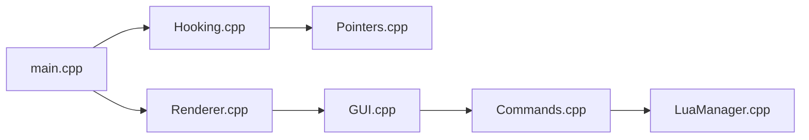

# YimMenu/YimMenuV2

> Experimental menu injected into GTA 5 Enhanced to modify the game, with Lua scripts.

## The problem
Modifying the GTA 5 Enhanced experience online or in single player.

## What it actually does
A DLL injected into the game: startup (`main.cpp`), hooks, pointers, D3D12 rendering, GUI, command registry, hotkeys, player, vehicle and world features, Lua scripts, settings. Opens with `INSERT` or `Ctrl+\`. Requires disabling BattlEye; the README admits there is no bypass and that public sessions may disconnect.

## How it is wired

## Trying it
Steps from the README: install FSL (optional), download YimMenuV2 from the Releases and an injector (Xenos), disable BattlEye, then inject `YimMenuV2.dll` at the main menu.

## Cost and gotchas
Free. Risk to your account (BattlEye disabled), loss of progress without FSL, game that no longer starts without FSL (delete `Documents/GTAV Enhanced/Profiles`).

## What it is not
Not a safe tool for an online account: the README acknowledges the absence of a bypass.

## Alternatives
No alternative named in the README.

## For you
Ignore: game modification by injection, outside your field and risky for your accounts.
