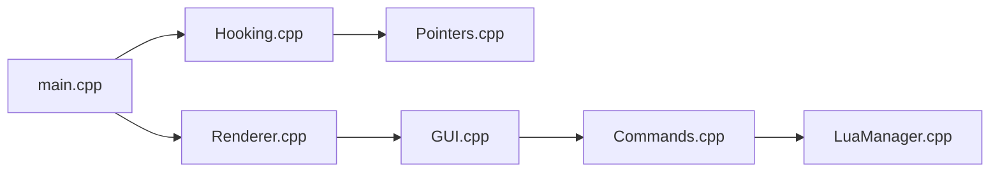

# YimMenu/YimMenuV2

> Menu expérimental injecté dans GTA 5 Enhanced pour modifier le jeu, avec scripts Lua.

## Le problème
Modifier l'expérience de GTA 5 Enhanced en ligne ou en solo.

## Ce que ça fait vraiment
Une DLL injectée dans le jeu : démarrage (`main.cpp`), hooks, pointeurs, rendu D3D12, GUI, registre de commandes, raccourcis, fonctionnalités joueur, véhicule et monde, scripts Lua, réglages. Ouverture par `INSERT` ou `Ctrl+\`. Exige de désactiver BattlEye ; le README admet l'absence de contournement et des déconnexions des sessions publiques.

## Comment c'est branché

## Essayer
Étapes du README : installer FSL (optionnel), télécharger YimMenuV2 dans les Releases et un injecteur (Xenos), désactiver BattlEye, puis injecter `YimMenuV2.dll` au menu principal.

## Coût et pièges
Gratuit. Risque pour le compte (BattlEye désactivé), perte de progression sans FSL, jeu qui ne démarre plus sans FSL (supprimer `Documents/GTAV Enhanced/Profiles`).

## Ce que ce n'est pas
Pas un outil sûr pour un compte en ligne : le README reconnaît l'absence de bypass.

## Alternatives
Aucune alternative nommée dans le README.

## Pour toi
À ignorer : modification de jeu par injection, hors métier et risquée pour tes comptes.

