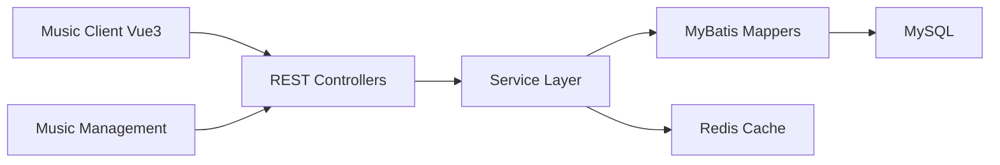

# Yin-Hongwei/music-website

> Complete music website built with Vue 3 and Spring Boot, shared by its author for learning purposes.

## The problem
Web development students lack complete examples linking client, administration, API, database and cache.

## What it actually does
A Vue 3 client, a Vue 3 administration console and a Spring Boot API with MyBatis, MySQL and Redis. Features: sign-up, search, playlists and singers, comments, favorites, a player with synchronized lyrics, and management of banners, users, songs and comments. Media files are downloaded from a network drive link.

## How it is wired


## Trying it
```bash
git clone git@github.com:Yin-Hongwei/music-website.git
cd music-website/music-server && ./mvnw clean spring-boot:run
cd music-client && npm install && npm run serve
cd deploy && docker compose up --build
```

## Cost and gotchas
Free, but it needs MySQL 8, Redis, JDK 8+ and Node 16+, plus the media files on a Chinese network drive (an account is probably required). The README declares the project non-commercial, with rights reserved by the author: the license is not identified.

## What it is not
Not reusable commercially: the README forbids commercial use. Not a ready-to-use music service, more of a learning project. README in Chinese.

## Alternatives
No alternative named in the README.

## For you
Ignore: unrelated to data or AI, and commercial use is forbidden by its author.
