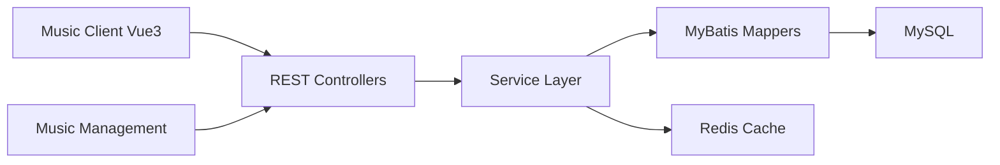

# Yin-Hongwei/music-website

> Site de musique complet en Vue 3 et Spring Boot, partagé par son auteur pour apprendre.

## Le problème
Les étudiants en développement web manquent d'exemples complets reliant client, administration, API, base de données et cache.

## Ce que ça fait vraiment
Un client Vue 3, une console d'administration Vue 3 et une API Spring Boot avec MyBatis, MySQL et Redis. Fonctions : inscription, recherche, playlists et chanteurs, commentaires, favoris, lecteur avec paroles synchronisées, gestion des bannières, utilisateurs, chansons et commentaires. Les médias se téléchargent depuis un lien de disque réseau.

## Comment c'est branché


## Essayer
```bash
git clone git@github.com:Yin-Hongwei/music-website.git
cd music-website/music-server && ./mvnw clean spring-boot:run
cd music-client && npm install && npm run serve
cd deploy && docker compose up --build
```

## Coût et pièges
Gratuit, mais il faut MySQL 8, Redis, JDK 8+ et Node 16+, plus les médias sur un disque réseau chinois (compte probable). Le README déclare le projet non commercial, droits réservés à l'auteur : la licence n'est pas identifiée.

## Ce que ce n'est pas
Pas réutilisable commercialement : le README refuse l'usage commercial. Pas un service musical prêt à l'emploi, plutôt un projet d'apprentissage. README en chinois.

## Alternatives
Aucune alternative nommée dans le README.

## Pour toi
À ignorer : sans lien avec data ou IA, et l'usage commercial est interdit par son auteur.

