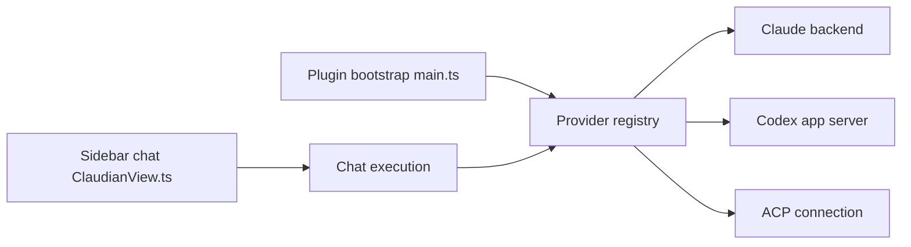

# YishenTu/claudian

> Obsidian plugin that turns your vault into the working directory of coding agents.

## The problem
Coding agents work on repositories; your Obsidian notes stay out of their direct reach.

## What it actually does
Integrates Claude Code, Codex, Grok Build, OpenCode, Pi and DeepSeek Harness into Obsidian: sidebar chat, inline editing with diff, `/` and `$` commands, `@` mentions of files and sessions, shared projects, messaging between sessions, MCP servers. Agents read, write and run commands in the vault. It relies on the installed CLIs and does not host a model.

## How it is wired


## Trying it
```bash
cd /path/to/vault/.obsidian/plugins
git clone https://github.com/YishenTu/claudian.git realclaudian
cd realclaudian
npm install
npm run build
```

## Cost and gotchas
At least one of the harnesses above, with a subscription or provider key. Obsidian 1.13.0+, desktop only. OpenCode v1 support ends on 2026-10-30. No telemetry, but your inputs and files go to the chosen provider.

## What it is not
No mobile version. Installation is from source: the README does not document the plugin store. Collaboration is a separate plugin.

## Alternatives
Claudian Collab, for collaboration; Copilot for Obsidian, another AI assistant built into Obsidian.

## For you
Worth watching: handy if your knowledge base lives in Obsidian, but it gives an agent write access to your vault.
