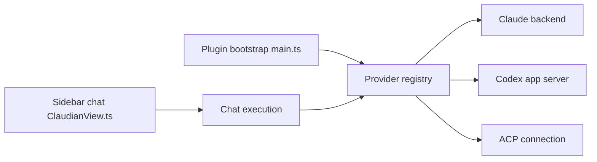

# YishenTu/claudian

> Plugin Obsidian qui fait de ton coffre le répertoire de travail d'agents de code.

## Le problème
Les agents de code travaillent sur des dépôts ; tes notes Obsidian restent hors de leur portée directe.

## Ce que ça fait vraiment
Intègre Claude Code, Codex, Grok Build, OpenCode, Pi et DeepSeek Harness dans Obsidian : discussion latérale, édition en ligne avec diff, commandes `/` et `$`, mentions `@` de fichiers et de sessions, projets partagés, messagerie entre sessions, serveurs MCP. Les agents lisent, écrivent et lancent des commandes dans le coffre. Il s'appuie sur les CLI installés, ne héberge pas de modèle.

## Comment c'est branché


## Essayer
```bash
cd /path/to/vault/.obsidian/plugins
git clone https://github.com/YishenTu/claudian.git realclaudian
cd realclaudian
npm install
npm run build
```

## Coût et pièges
Au moins un des harnais ci-dessus, avec abonnement ou clé de fournisseur. Obsidian 1.13.0+, bureau seulement. Le support OpenCode v1 prend fin le 2026-10-30. Pas de télémétrie, mais tes entrées et fichiers partent chez le fournisseur choisi.

## Ce que ce n'est pas
Pas de version mobile. L'installation est depuis les sources : le README ne documente pas le magasin de plugins. La collaboration est un plugin séparé.

## Alternatives
Claudian Collab, pour la collaboration ; Copilot for Obsidian, autre assistant IA intégré à Obsidian.

## Pour toi
À surveiller : pratique si ta base de connaissances vit dans Obsidian, mais donne à un agent accès en écriture à ton coffre.

