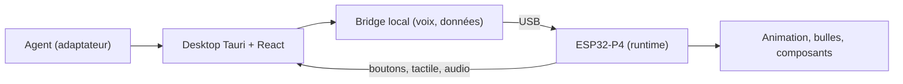

# YizhengWw/HachimoDock

> ESP32-P4 desktop terminal that displays the status of your AI agents and takes voice as input.

## The problem
When an AI agent works in the background, nothing shows its status unless you keep its window in view.

## What it actually does
A Windows or macOS client (Tauri and React) talks to an ESP32-P4 board over USB. The screen shows the agents' thinking, running, waiting and error states (Codex, Claude, OpenClaw, MiMoCode, WorkBuddy, DeepSeek Harness), takes voice dictation to be confirmed before sending, and hosts small components and games created with the `petui` skill. It provides no service key: voice and dialogue use your own credentials.

## How it is wired

## Trying it
The README gives no shell command: you download the client, plug the board in over USB, and follow the interface steps. The full flash uses Python 3.10+ scripts with esptool 5.4.0.

## Cost and gotchas
You need the hardware (ESP32-P4, 2.8-inch DSI screen) and your own keys for the voice and dialogue services. The v1 and v3 images are not interchangeable and a full flash erases data. No Linux or Intel Mac package; the Windows installer is not signed.

## What it is not
Not standalone software: without the board, it is of little use. The README, in Chinese, states that not all hardware and features have been validated on a real device. Some Xiaomi MiLoco elements are under a non-commercial license.

## Alternatives
No alternative named in the README.

## For you
Ignore: a hardware gadget centered on desktop agents, with an unclear license and restricted commercial use; little value for a data/AI/MLOps profile.
