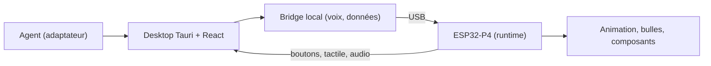

# YizhengWw/HachimoDock

> Terminal de bureau ESP32-P4 qui affiche l'état de tes agents IA et prend la voix en entrée.

## Le problème
Quand un agent IA travaille en arrière-plan, rien ne montre son état sans garder la fenêtre sous les yeux.

## Ce que ça fait vraiment
Un client Windows ou macOS (Tauri et React) dialogue avec une carte ESP32-P4 en USB. L'écran affiche pensée, exécution, attente et erreur des agents (Codex, Claude, OpenClaw, MiMoCode, WorkBuddy, DeepSeek Harness), prend une dictée vocale à valider avant envoi et héberge de petits composants et jeux créés avec le skill `petui`. Il ne fournit pas de clé de service : voix et dialogue utilisent tes propres identifiants.

## Comment c'est branché

## Essayer
Le README ne donne pas de commande shell : on télécharge le client, on branche la carte en USB, on suit les étapes de l'interface. Le flash complet utilise des scripts Python 3.10+ avec esptool 5.4.0.

## Coût et pièges
Il faut le matériel (ESP32-P4, écran DSI de 2,8 pouces) et tes clés pour les services de voix et de dialogue. Les images v1 et v3 ne sont pas interchangeables et un flash complet efface les données. Pas de paquet Linux ni Intel Mac ; l'installateur Windows n'est pas signé.

## Ce que ce n'est pas
Ce n'est pas un logiciel seul : sans la carte, il sert peu. Le README, en chinois, précise que matériel et fonctions ne sont pas tous validés sur appareil réel. Des éléments Xiaomi MiLoco sont soumis à une licence non commerciale.

## Alternatives
Aucune alternative nommée dans le README.

## Pour toi
À ignorer : gadget matériel centré sur des agents de bureau, avec licence peu claire et usage commercial restreint ; peu d'apport pour un profil data/IA/MLOps.

