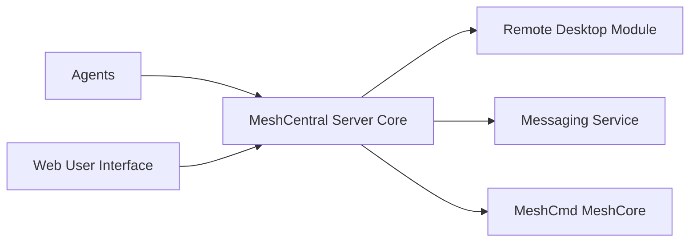

# Ylianst/MeshCentral

> Self-hosted website for managing and remotely controlling fleets of computers.

## The problem
Remotely administer machines (desktop, terminal, files) without a third-party cloud service.

## What it actually does
Node.js server (`meshcentral.js`) plus cross-platform agents (Windows, macOS, Linux, Android). The agents connect to the server; the web interface offers remote desktop, terminal and file management. Modules: messaging, MeshCmd/MeshCore, emails, translations. Documentation on 2FA, SSO, Let's Encrypt, reverse proxy, Vault.

## How it is wired

## Trying it
README has no install command: videos and online documentation. Not documented here.

## Cost and gotchas
Free. A server exposed to the Internet with remote access to every machine: hardening and 2FA are essential.

## What it is not
Not an infrastructure monitoring tool nor a job orchestrator.

## Alternatives
No alternative named in the README.

## For you
Worth watching for remotely driving workstations or GPUs outside a cluster; otherwise prefer your existing MLOps tooling.
