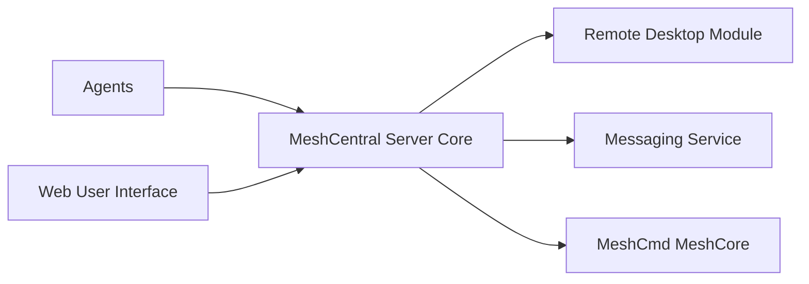

# Ylianst/MeshCentral

> Site web auto-hébergé de gestion et de prise en main à distance de parcs d'ordinateurs.

## Le problème
Administrer à distance des machines (bureau, terminal, fichiers) sans service cloud tiers.

## Ce que ça fait vraiment
Serveur Node.js (`meshcentral.js`) plus agents multiplateformes (Windows, macOS, Linux, Android). Les agents se connectent au serveur ; l'interface web offre bureau distant, terminal et gestion de fichiers. Modules : messagerie, MeshCmd/MeshCore, courriels, traductions. Documentation sur 2FA, SSO, Let's Encrypt, reverse proxy, Vault.

## Comment c'est branché

## Essayer
README sans commande d'installation : vidéos et documentation en ligne. Non documenté ici.

## Coût et pièges
Gratuit. Serveur exposé sur Internet avec accès à distance sur toutes les machines : durcissement et 2FA indispensables.

## Ce que ce n'est pas
Pas un outil de supervision d'infrastructure ni d'orchestration de jobs.

## Alternatives
Aucune alternative nommée dans le README.

## Pour toi
À surveiller pour piloter à distance des postes ou GPU hors cluster ; sinon préférer ton outillage MLOps existant.

