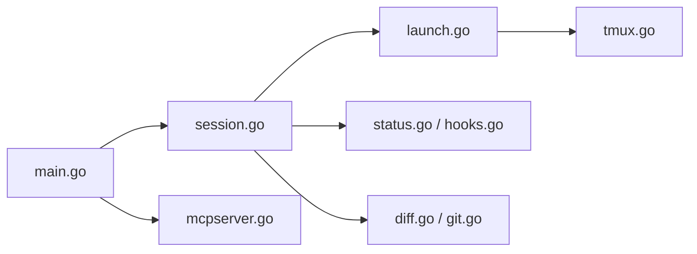

# YoanWai/agent-manager

> Terminal dashboard for driving several coding agents, each in its own persistent tmux session.

## The problem
With several agents running, you hunt through tabs to find which one has finished, which is blocked, and you lose track of the changes.

## What it actually does
Each agent (Claude Code, Codex, OpenCode, Gemini CLI…) runs in a private tmux session (`agentmgr` server), listed with its live status and grouped in a project tree. You reply without attaching (`space`), resurrect a session (`v`), and review full-file diffs (`ctrl+r`) with comments sent back to the agent. Agents can launch others through MCP tools.

## How it is wired


## Trying it
```bash
brew install agent-manager
# or
curl -fsSL https://raw.githubusercontent.com/YoanWai/agent-manager/main/install.sh | sh
agent-manager
```

## Cost and gotchas
Free, but uses your own agent subscriptions and logins. Requires tmux 3.1+ and git. Windows only via WSL2. No cost tracking. 60 open issues.

## What it is not
Not an agent: it is a layer on top of the installed CLIs. No usage tracking.

## Alternatives
No alternative named in the README.

## For you
Worth watching: handy if you run several agents in parallel, but the project is recent (July 2026) and evolving fast.
