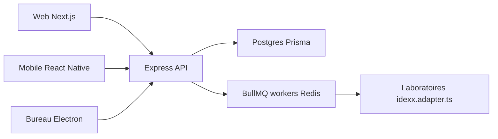

# YosemiteCrew/Yosemite-Crew

> Open veterinary practice management system, with web, mobile, desktop and a developer platform.

## The problem
Veterinary software is closed, on rigid subscriptions and without free access to clinical data.

## What it actually does
A pnpm and Turborepo monorepo: web interface (Next.js), API (Express, Prisma, Socket.IO, BullMQ), mobile app (React Native), desktop client (Electron, offline sync) and documentation. Postgres (Supabase) isolates customers by schema. FHIR R4 routes, laboratory integrations (IDEXX, Merck), Stripe payments, SuperTokens authentication, AWS services.

## How it is wired


## Trying it
```bash
pnpm install
cp apps/backend/.env.example apps/backend/.env
cp apps/frontend/.env.example apps/frontend/.env
pnpm run dev
```

## Cost and gotchas
Node 20, pnpm 8, PostgreSQL and Redis must be reachable at startup. The mobile app needs its own configuration and Firebase files. Access to dev environments is on request. 174 open issues.

## What it is not
Not a turnkey product: you have to host and configure it. License present but not recognized: read it before use. Regulatory compliance is claimed, not demonstrated here.

## Alternatives
No alternative named in the README (it compares the ecosystem to that of WordPress plugins).

## For you
Ignore: outside your field; its interest is the FHIR and multi-tenant architecture, not a tool for your data/AI work.
