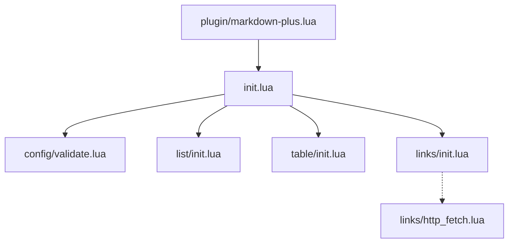

# YousefHadder/markdown-plus.nvim

> Neovim plugin that brings Typora or Obsidian style Markdown editing: lists, tables, headings, links.

## The problem
Editing Markdown in Neovim without fine-grained handling of lists, tables and footnotes.

## What it actually does
Modules by function: inline formatting, headings and table of contents, lists (continuation, renumbering), tables, footnotes, code blocks, callouts, images, links with optional smart paste. No dependencies, everything goes through `<Plug>` mappings.

## How it is wired


## Trying it
```lua
{
  "yousefhadder/markdown-plus.nvim",
  ft = "markdown",
  opts = {},
}
```

## Cost and gotchas
Neovim 0.11+. Version 2.0 with breaking changes: read the migration guide. Smart paste makes network requests, disabled by default.

## What it is not
Not a rendered Markdown preview nor a note-taking tool: it edits text.

## Alternatives
`obsidian.nvim`, `markdown.nvim`, `mkdnflow.nvim` and `mdnotes.nvim`, mentioned in the README.

## For you
Ignore: Neovim editor comfort, no direct contribution to data/AI/MLOps work.
