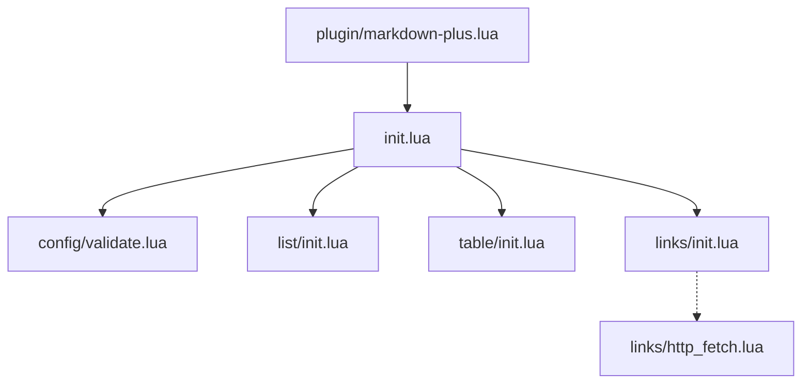

# YousefHadder/markdown-plus.nvim

> Plugin Neovim qui apporte l'édition Markdown de Typora ou Obsidian : listes, tableaux, titres, liens.

## Le problème
Éditer du Markdown dans Neovim sans gestion fine des listes, tableaux et notes de bas de page.

## Ce que ça fait vraiment
Modules par fonction : mise en forme en ligne, titres et table des matières, listes (continuation, renumérotation), tableaux, notes de bas de page, blocs de code, callouts, images, liens avec collage intelligent optionnel. Sans dépendance, tout passe par des mappings `<Plug>`.

## Comment c'est branché


## Essayer
```lua
{
  "yousefhadder/markdown-plus.nvim",
  ft = "markdown",
  opts = {},
}
```

## Coût et pièges
Neovim 0.11+. Version 2.0 avec ruptures : lire le guide de migration. Le collage intelligent fait des requêtes réseau, désactivé par défaut.

## Ce que ce n'est pas
Pas un aperçu rendu du Markdown ni un outil de notes : il édite du texte.

## Alternatives
`obsidian.nvim`, `markdown.nvim`, `mkdnflow.nvim` et `mdnotes.nvim`, cités dans le README.

## Pour toi
Ignorer : confort d'éditeur Neovim, aucun apport direct au travail data/IA/MLOps.

