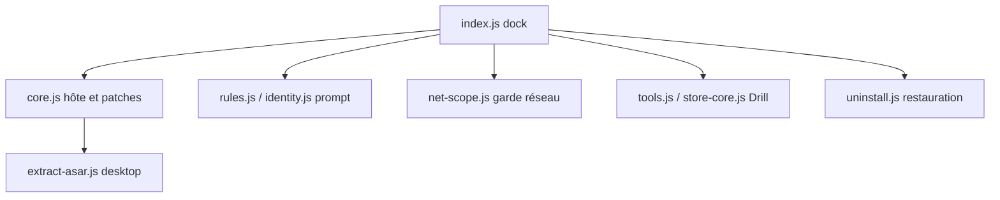

# YuJunZhiXue/dsh-purge

> Plugin that locally modifies DeepSeek Harness to replace its default prompts and rules, intended for red-team evaluations.

## The problem
The default policies of an agent harness (prompts, guardrails, sandbox) are opaque. It is hard to tell a host-layer block from a model refusal.

## What it actually does
Patches the locally installed `@deepseek-ai` packages (backup `.dshpurge.bak`, restore possible). Injects an encrypted prompt shipped with the plugin and manages AGENTS.md / CLAUDE.md rule sets. Adds a panel with two pages: Clean (patches, prompt) and Drill (authorized evaluation exercises). The public version limits targets to loopback and RFC1918, after DNS resolution. Only targets the announced DSH 0.2.x (0.2.1-rc.3 and later are not supported).

## How it is wired


## Trying it
```bash
dsh plugin --profile web add https://codeload.github.com/YuJunZhiXue/dsh-purge/tar.gz/refs/heads/master
# puis relancer l'hôte, bouton dsh-purge > Clean > Apply
dsh-purge --status
dsh-purge --revert
dsh-purge --uninstall
```

## Cost and gotchas
Free, but requires an already installed DeepSeek Harness at a specific version. Modifies files of the official packages; the harness marketplace does not work for installing it.

## What it is not
Not a public scanner nor an attack kit against third-party sites, according to the README. It bypasses the harness's original settings: this may violate the provider's terms of use. The README adds clauses (resale forbidden, attribution required) on top of Apache-2.0, and the author's text hints at outside pressure: the actual terms are unclear. Skills and the knowledge base are not included.

## Alternatives
Not documented in the README: no alternative repository is named.

## For you
Ignore: a bypass tool for a single harness, tied to specific versions, with an ambiguous license and unrelated to data / MLOps work; consider it only for an authorized security evaluation on your own installation.
