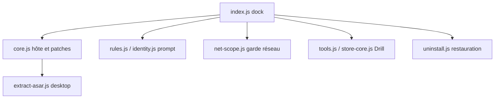

# YuJunZhiXue/dsh-purge

> Plugin qui modifie localement DeepSeek Harness pour remplacer ses prompts et règles par défaut, destiné aux évaluations red-team.

## Le problème
Les politiques par défaut d'un harnais d'agent (prompts, garde-fous, sandbox) sont opaques. Difficile de séparer un blocage de la couche hôte d'un refus du modèle.

## Ce que ça fait vraiment
Patche les paquets `@deepseek-ai` installés en local (sauvegarde `.dshpurge.bak`, restauration possible). Injecte un prompt chiffré livré avec le plugin et gère des jeux de règles AGENTS.md / CLAUDE.md. Ajoute un panneau avec deux pages : Clean (patches, prompt) et Drill (exercices d'évaluation autorisés). La version publique limite les cibles à loopback et RFC1918, après résolution DNS. Ne vise que le DSH 0.2.x annoncé (0.2.1-rc.3 et suivants non supportés).

## Comment c'est branché


## Essayer
```bash
dsh plugin --profile web add https://codeload.github.com/YuJunZhiXue/dsh-purge/tar.gz/refs/heads/master
# puis relancer l'hôte, bouton dsh-purge > Clean > Apply
dsh-purge --status
dsh-purge --revert
dsh-purge --uninstall
```

## Coût et pièges
Gratuit, mais exige un DeepSeek Harness déjà installé et une version précise. Modifie des fichiers des paquets officiels ; le marketplace du harnais ne fonctionne pas pour l'installer.

## Ce que ce n'est pas
Pas un scanner public ni un kit d'attaque contre des sites tiers, selon le README. Il contourne les réglages d'origine du harnais : cela peut violer les conditions d'utilisation du fournisseur. Le README ajoute des clauses (revente interdite, attribution obligatoire) en plus d'Apache-2.0, et le texte de l'auteur évoque une pression extérieure : les conditions réelles sont floues. Les compétences et la base de connaissances ne sont pas incluses.

## Alternatives
Non documenté dans le README : aucun dépôt alternatif n'est nommé.

## Pour toi
Ignorer : outil de contournement d'un seul harnais, lié à des versions précises, avec licence ambiguë et sans lien avec un travail data / MLOps ; à ne considérer que pour une évaluation de sécurité autorisée sur ta propre installation.

