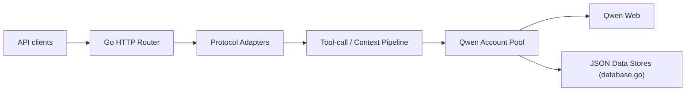

# YuJunZhiXue/qwen2API

> Self-hosted gateway that exposes Qwen Web through OpenAI, Anthropic and Gemini compatible APIs.

## The problem
Using Qwen's web interface from tools that speak the OpenAI, Anthropic or Gemini protocols.

## What it actually does
Go backend with a React WebUI: protocol adapters translate requests (`/v1/chat/completions`, `/v1/messages`, `generateContent`, images, videos), a context and tool-call pipeline prepares them, then a pool of Qwen accounts sends them to Qwen Web. Account management, downstream API keys, settings, chat/image/video tests and health probes.

## How it is wired


## Trying it
```bash
mkdir -p data logs
docker compose pull
docker compose up -d
docker compose logs -f qwen2api
```
With a `.env` (`ADMIN_KEY`) and the README's `docker-compose.yml` (image `yujunzhixue/qwen2api:latest`, port 7860).

## Cost and gotchas
Free on the gateway side but requires Qwen accounts (tokens, possibly a password in the environment). The README asks you to check the upstream platforms' rules; no license declared.

## What it is not
Not an official Qwen API: it goes through the web interface, so it is fragile and subject to the provider's rules.

## Alternatives
No alternative named in the README.

## For you
Ignore: depends on scraping a third-party web service, with no declared license; use the provider's official API instead.
