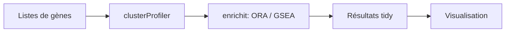

# YuLab-SMU/clusterProfiler

> R package for gene functional enrichment analysis, for bioinformaticians.

## The problem
Interpreting gene lists in terms of biological functions across many species.

## What it actually does
A unified functional annotation interface (ORA, GSEA, topology-aware enrichment) with the `enrichit` engine, results that can be manipulated and visualised, and comparison of several treatments or time points in a single run. Distributed through Bioconductor.

## How it is wired


## Trying it
```r
if (!requireNamespace("BiocManager", quietly = TRUE)) install.packages("BiocManager")
BiocManager::install("clusterProfiler")
remotes::install_github("YuLab-SMU/clusterProfiler")
```

## Cost and gotchas
Free. No licence declared in the catalogue; 251 open issues.

## What it is not
Not a sequencing tool: it operates on results already produced.

## Alternatives
No alternative named in the README.

## For you
Keep an eye on it: the reference if you do bioinformatics in R; otherwise outside your scope, and the missing licence needs clarifying.
