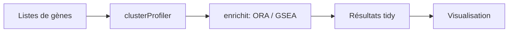

# YuLab-SMU/clusterProfiler

> Paquet R d'analyse d'enrichissement fonctionnel de gènes, pour bio-informaticiens.

## Le problème
Interpréter des listes de gènes en termes de fonctions biologiques sur de nombreuses espèces.

## Ce que ça fait vraiment
Interface unifiée d'annotation fonctionnelle (ORA, GSEA, enrichissement tenant compte de la topologie) avec le moteur `enrichit`, résultats manipulables et visualisables, comparaison de plusieurs traitements ou instants dans une seule exécution. Distribué par Bioconductor.

## Comment c'est branché


## Essayer
```r
if (!requireNamespace("BiocManager", quietly = TRUE)) install.packages("BiocManager")
BiocManager::install("clusterProfiler")
remotes::install_github("YuLab-SMU/clusterProfiler")
```

## Coût et pièges
Gratuit. Aucune licence déclarée au catalogue ; 251 issues ouvertes.

## Ce que ce n'est pas
Pas un outil de séquençage : il opère sur des résultats déjà produits.

## Alternatives
Aucune alternative nommée dans le README.

## Pour toi
À surveiller : référence si tu fais de la bio-informatique en R ; sinon hors de ton périmètre, et la licence manquante est à clarifier.

