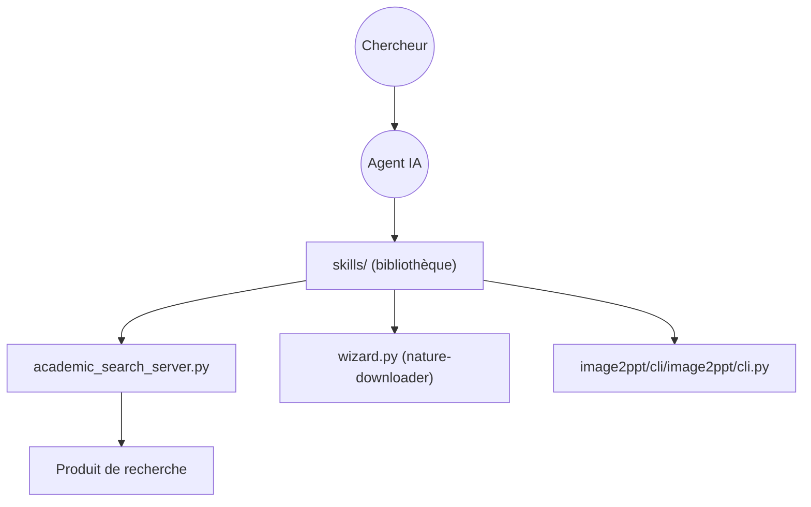

# Yuan1z0825/nature-skills

> A collection of skills for agents involved in research: reading, writing, proofreading, creating figures, citing sources, and handling patents.

## The problem
Writing, reviewing, and presenting a scientific article requires many repetitive tasks, which the agent performs poorly without a systematic approach.

## What it actually does
Approximately twenty skills are included in the `SKILL.md` file: style review, writing, review simulation, responding to reviewers, figures, academic research (using MCP with PubMed and Scopus), PDF download, citations, converting images to editable PPTX, and article to patent conversion. A common package, `nature-shared`, serves as a foundation. The status ranges from Draft to Stable. The README also contains links to commercial services (GPT/Claude account recharge, paid community).

## How it is wired


## Trying it
```bash
npx skills add Yuan1z0825/nature-skills --list
npx skills add Yuan1z0825/nature-skills --agent codex --skill nature-figure --yes --copy
```

## Cost and gotchas
Node 18+. Advanced skills require Python, Playwright, access to a PubMed or Scopus email account, or access to external image services with keys. Some skills rely on external image services with keys.

## What it is not
Not a single-purpose tool: a collection with varying levels of maturity. The author also offers services (replacements, community support).

## Alternatives
No alternative is mentioned in the README (it cites OpenClaw/OpenCode/Hermes for integration).

## For you
Relevant for assisted scientific writing; try the reading or research skill, by reading the skills before providing them to your agent.
