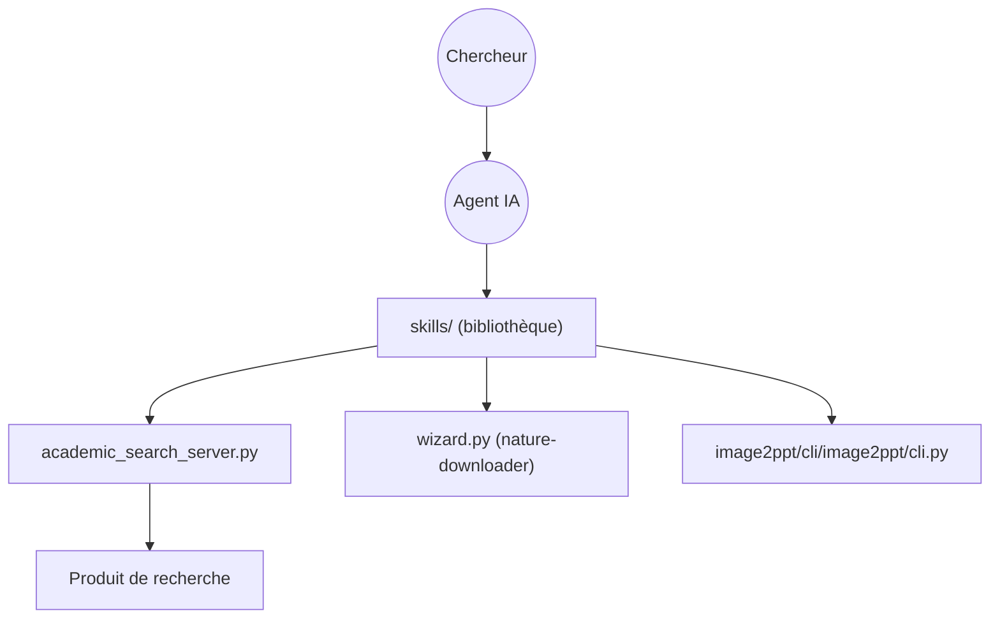

# Yuan1z0825/nature-skills

> Bibliothèque de skills d'agent pour la recherche : lecture, rédaction, relecture, figures, citations, brevets.

## Le problème
Rédiger, vérifier et présenter un article scientifique demande beaucoup de tâches répétitives que l'agent fait mal sans méthode.

## Ce que ça fait vraiment
Environ vingt skills `SKILL.md` :relecture de style Nature, rédaction, simulation de relecture, réponse aux relecteurs, figures, recherche académique (MCP avec PubMed, Scopus), téléchargement de PDF, citations, conversion image vers PPTX éditable, article vers brevet. Un paquet `nature-shared` sert de base commune. Les statuts vont de Draft à Stable. Le README contient aussi des liens commerciaux (recharge de comptes GPT/Claude, communauté payante).

## Comment c'est branché


## Essayer
```bash
npx skills add Yuan1z0825/nature-skills --list
npx skills add Yuan1z0825/nature-skills --agent codex --skill nature-figure --yes --copy
```

## Coût et pièges
Node 18+. Les skills avancés demandent Python, Playwright, un e-mail PubMed ou des accès Scopus. Certains skills s'appuient sur des services d'images externes avec clés.

## Ce que ce n'est pas
Pas un outil unique : une collection au niveau de maturité inégal. L'auteur y vend aussi des services (recharges, communauté).

## Alternatives
Aucune alternative nommée dans le README (il cite OpenClaw/OpenCode/Hermes pour l'intégration).

## Pour toi
Pertinent pour de l'écriture scientifique assistée ; essaie le skill de lecture ou de recherche, en lisant les skills avant de les donner à ton agent.

