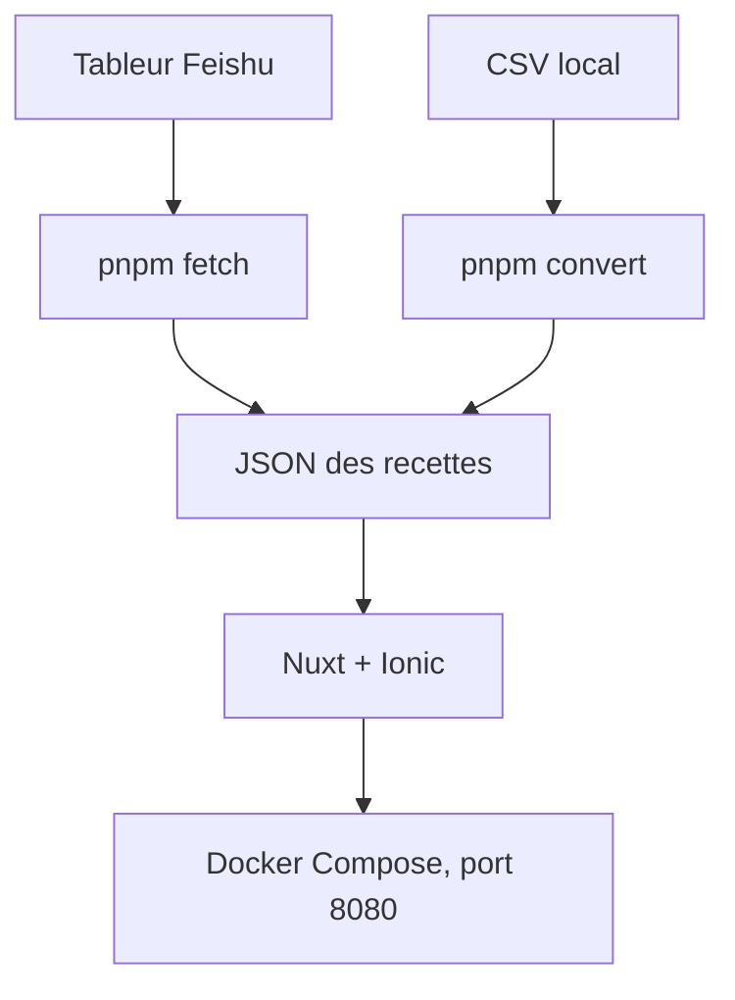

# YunYouJun/cook

> Chinese-language cooking recipe site, with data drawn from a Feishu spreadsheet, for cooking with few ingredients.

## The problem
Finding recipes that can be made with limited ingredients, during home isolation.

## What it actually does
Nuxt and Ionic web application that displays recipes. The data comes from a Feishu spreadsheet (`pnpm fetch`) or from a local CSV converted to JSON (`pnpm convert`). An iOS SwiftUI application is in `apps/ios`; the WeChat mini-program version has been removed.

## How it is wired
Simplified diagram based on the sheet, no diagram provided.


## Trying it
```bash
pnpm install
pnpm fetch
pnpm dev
# http://localhost:3333
docker compose up -d --build
# http://localhost:8080
```

## Cost and gotchas
Free. Microsoft Clarity is used for statistics (can be disabled with an empty project ID). The project is mainly in Chinese and will not be translated.

## What it is not
Not a data or AI project: it is a recipe site. The README is not translated into English.

## Alternatives
Anduin2017/HowToCook, from which part of the texts and images is taken.

## For you
To ignore: cooking application unrelated to data, AI or MLOps work, relevant only as an example of a Nuxt site.
