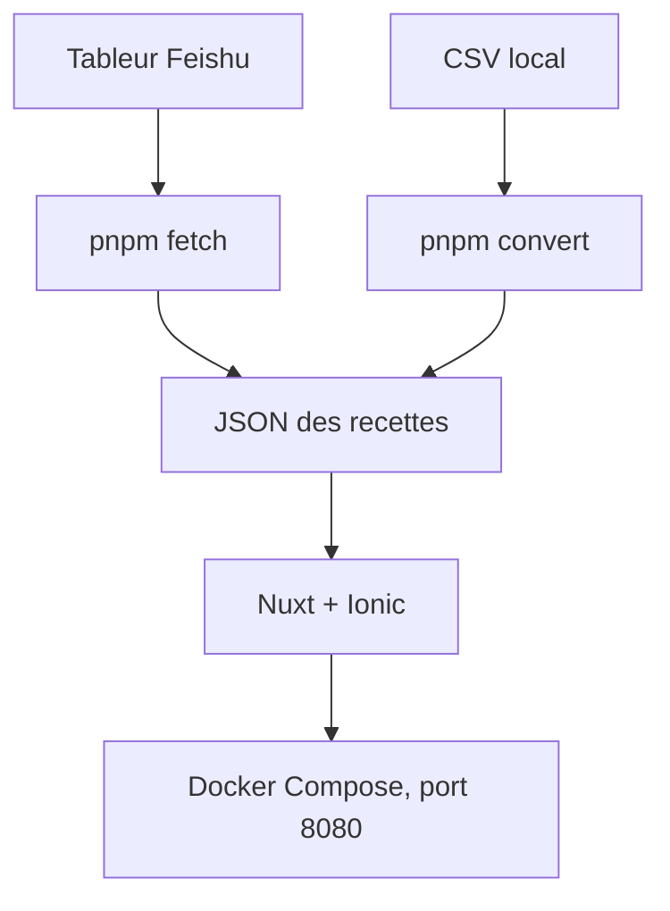

# YunYouJun/cook

> Site de recettes de cuisine en chinois, avec données tirées d'un tableur Feishu, pour cuisiner avec peu d'ingrédients.

## Le problème
Trouver des recettes réalisables avec des ingrédients limités, en période d'isolement à la maison.

## Ce que ça fait vraiment
Application web Nuxt et Ionic qui affiche des recettes. Les données viennent d'un tableur Feishu (`pnpm fetch`) ou d'un CSV local converti en JSON (`pnpm convert`). Une application iOS SwiftUI est dans `apps/ios` ; la version mini-programme WeChat est retirée.

## Comment c'est branché
Schéma simplifié d'après la fiche, sans diagramme fourni.


## Essayer
```bash
pnpm install
pnpm fetch
pnpm dev
# http://localhost:3333
docker compose up -d --build
# http://localhost:8080
```

## Coût et pièges
Gratuit. Microsoft Clarity est utilisé pour les statistiques (désactivable avec un identifiant de projet vide). Le projet est principalement en chinois et ne sera pas traduit.

## Ce que ce n'est pas
Ce n'est pas un projet de données ni d'IA : c'est un site de recettes. Le README n'est pas traduit en anglais.

## Alternatives
Anduin2017/HowToCook, dont une partie des textes et images est reprise.

## Pour toi
À ignorer : application de cuisine sans lien avec le travail data, IA ou MLOps, pertinente seulement comme exemple de site Nuxt.

