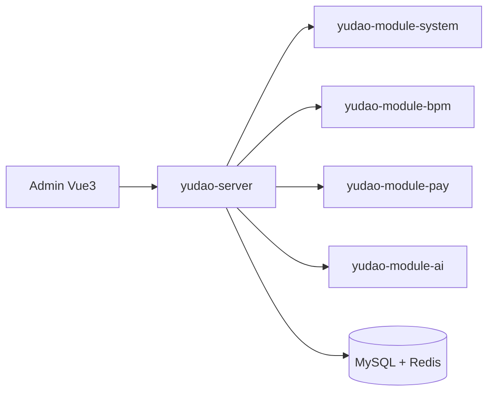

# YunaiV/ruoyi-vue-pro

> A Chinese-language Spring Boot + Vue administration platform with workflow, payment, ERP, CRM and AI.

## The problem
Building an enterprise back office (permissions, multi-tenancy, workflow, payment) from scratch takes months.

## What it actually does
Multi-module Spring Boot backend (MyBatis Plus, Redis, Flowable for approval flows), Vue3/Vue2 administration, uni-app mobile. Modules: system, infrastructure, BPMN workflow, payment, reports, WeChat, shop, ERP, CRM, AI, IoT, messaging. Java/Vue/SQL code generator. JDK 8, 17/21, 25 versions on separate branches.

## How it is wired

## Trying it
The README gives no command: it points to a getting-started document and a video (links absent from the text provided).

## Cost and gotchas
Free (MIT); Java, MySQL, Redis and Node must be installed. Documentation in Chinese. The author also offers outsourcing services.

## What it is not
Not a data or AI tool: the AI module is just one module among others, with no detail in the README. Screenshots section is empty in the text received.

## Alternatives
- yudao-cloud: the same platform as Spring Cloud microservices.

## For you
Ignore: an enterprise application foundation, with no direct link to data/AI work.
