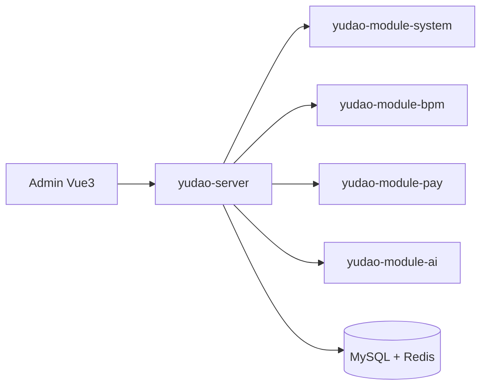

# YunaiV/ruoyi-vue-pro

> Plateforme d'administration Spring Boot + Vue en chinois, avec workflow, paiement, ERP, CRM et IA.

## Le problème
Construire un back-office d'entreprise (droits, multi-tenant, workflow, paiement) depuis zéro coûte des mois.

## Ce que ça fait vraiment
Backend Spring Boot multi-modules (MyBatis Plus, Redis, Flowable pour les flux d'approbation), administration Vue3/Vue2, mobile uni-app. Modules : système, infrastructure, workflow BPMN, paiement, rapports, WeChat, boutique, ERP, CRM, IA, IoT, messagerie. Générateur de code Java/Vue/SQL. Versions JDK 8, 17/21, 25 sur des branches.

## Comment c'est branché

## Essayer
Le README ne donne pas de commande : il renvoie à un document de démarrage et à une vidéo (liens absents du texte fourni).

## Coût et pièges
Gratuit (MIT) ; Java, MySQL, Redis et Node à installer. Documentation en chinois. L'auteur propose aussi des prestations d'externalisation.

## Ce que ce n'est pas
Pas un outil data ou IA : le module IA n'est qu'un module parmi d'autres, sans détail dans le README. Section captures d'écran vide dans le texte reçu.

## Alternatives
- yudao-cloud : même plateforme en microservices Spring Cloud.

## Pour toi
Ignorer : socle applicatif d'entreprise, sans lien direct avec le travail data/IA.

