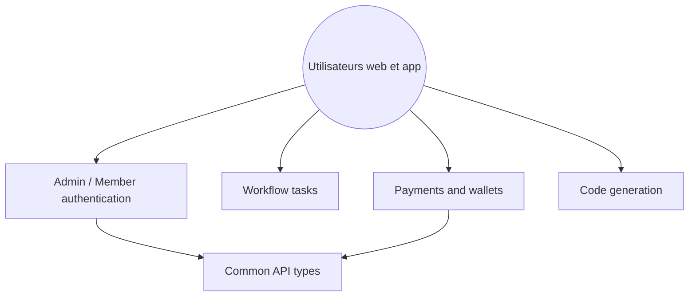

# YunaiV/yudao-cloud

> Chinese rapid-development platform in Spring Cloud, with workflow, payment, ERP, CRM and AI.

## The problem
Building an enterprise back office (permissions, multi-tenant, workflow, payment) in Java from scratch takes months.

## What it actually does
Provides a microservices skeleton (Spring Cloud Alibaba, Nacos, Sentinel, Seata) with system modules, Flowable workflow, payment, reporting, commerce, ERP, CRM, IoT, AI, IM. A generator produces the Java, Vue and SQL code. It supports many databases, including Chinese ones. README and demos are in Chinese.

## How it is wired

## Trying it
No command in the README: startup is described in external documentation. To write yourself: clone the repo, choose the branch (`master`, `master-jdk17` or `master-jdk25`), import the SQL script from the `sql` folder, start Nacos then the modules.

## Cost and gotchas
Free (MIT). Needs MySQL, Redis, Nacos and a JDK: a heavy stack. Dependency versions on the `master` branch are old (Spring Boot 2.7).

## What it is not
Not a data or AI tool: AI is just one module among others. Not a lightweight library: it is a complete system to adopt as a whole.

## Alternatives
- YunaiV/ruoyi-vue-pro: same author, Spring Boot monolith version.
- yudao-cloud-mini: lightened version, system and infrastructure only.

## For you
Ignore: general-purpose Java management platform, outside data, AI or MLOps needs, unless you must deliver an enterprise back office.
