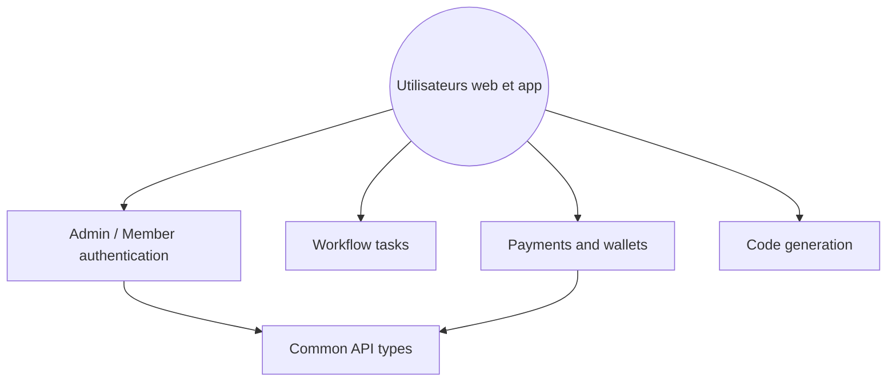

# YunaiV/yudao-cloud

> Plateforme chinoise de développement rapide en Spring Cloud, avec workflow, paiement, ERP, CRM et IA.

## Le problème
Monter un back-office d'entreprise (droits, multi-tenant, workflow, paiement) en Java depuis zéro prend des mois.

## Ce que ça fait vraiment
Fournit un squelette microservices (Spring Cloud Alibaba, Nacos, Sentinel, Seata) avec modules système, workflow Flowable, paiement, reporting, commerce, ERP, CRM, IoT, IA, IM. Un générateur produit le code Java, Vue et SQL. Il prend en charge de nombreuses bases, y compris chinoises. README et démos sont en chinois.

## Comment c'est branché

## Essayer
Aucune commande dans le README : démarrage décrit dans une documentation externe. À écrire : cloner le dépôt, choisir la branche (`master`, `master-jdk17` ou `master-jdk25`), importer le script SQL du dossier `sql`, démarrer Nacos puis les modules.

## Coût et pièges
Gratuit (MIT). Il faut MySQL, Redis, Nacos et un JDK : pile lourde. Les versions de dépendances de la branche `master` sont anciennes (Spring Boot 2.7).

## Ce que ce n'est pas
Pas un outil data ou IA : l'IA n'est qu'un module parmi d'autres. Pas une bibliothèque légère : c'est un système complet à adopter en bloc.

## Alternatives
- YunaiV/ruoyi-vue-pro : même auteur, version monolithe Spring Boot.
- yudao-cloud-mini : version allégée, système et infrastructure seulement.

## Pour toi
À ignorer : plateforme de gestion Java généraliste, hors des besoins data, IA ou MLOps, sauf si tu dois livrer un back-office d'entreprise.

