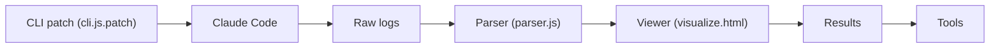

# Yuyz0112/claude-code-reverse

> Analysis of Claude Code's internals through its API traffic, with extracted prompts and tools.

## The problem
Understanding how a mature coding agent orchestrates its prompts and tools when the source code is minified.

## What it actually does
A `cli.js.patch` patch intercepts the Anthropic SDK's `beta.messages.create` and logs requests and responses. `parser.js` structures the logs, `visualize.html` displays them and spots the common prompts. The results folder contains the prompts (workflow, compaction, topic detection, IDE) and the tool definitions in YAML. The v1 (LLM-based bundle analysis) is archived.

## How it is wired


## Trying it
```bash
which claude
mv cli.js cli.bak
js-beautify cli.bak > cli.js
```
Then apply `cli.js.patch` (details in the repo); a `messages.log` is created on every launch.

## Cost and gotchas
Assumes an installed Claude Code (account at your expense). Modifying installed files may break on the next update. No license declared: reuse of the extracted prompts is to be checked. The README notes that this kind of reverse engineering is not supported by Anthropic.

## What it is not
Not a tool to deploy: a study, dated July 2025 (Sonnet 4, Haiku 3.5 models).

## Alternatives
No alternative named in the README.

## For you
Worth watching as reading material: useful for designing your own agents (prompts, sub-agents, compaction), but unlicensed and frozen on an old version.
