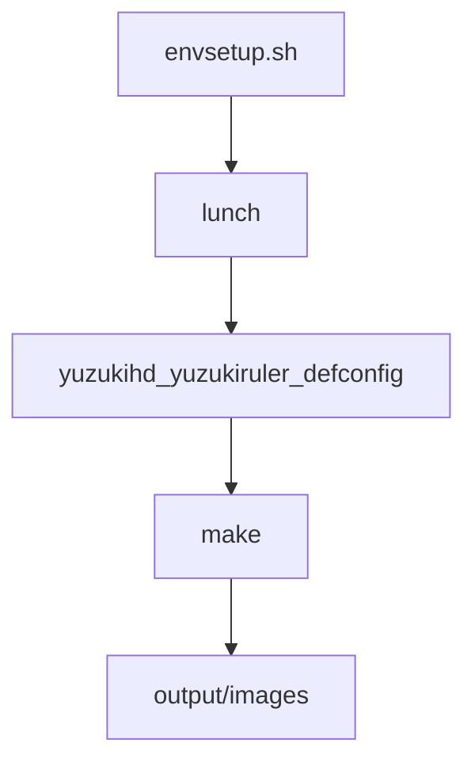

# YuzukiHD/Buildroot-YuzukiSBC

> Buildroot packages for building an embedded Linux on Allwinner YuzukiHD boards.

## The problem
Building a Linux image for small Allwinner boards (F1C100s, V3s, D1, T113, H616) requires a prepared cross-compilation environment.

## What it actually does
An adaptation of Buildroot with scripts (envsetup.sh, lunch) and per-board configurations. You pick a defconfig, then `make` builds the kernel, the bootloader and the filesystem.

## How it is wired
Simplified diagram based on the sheet, no diagram provided.


## Trying it
```bash
git clone https://github.com/yuzukihd/Buildroot-YuzukiSBC
cd Buildroot-YuzukiSBC
source envsetup.sh
lunch
make yuzukihd_yuzukiruler_defconfig
make
```

## Cost and gotchas
Archived repository, last push in 2023. A full Buildroot build is long and requires Linux.

## What it is not
Not a ready-to-use system nor a maintained distribution.

## Alternatives
Buildroot itself (the README reuses its text).

## For you
Ignore: archived, embedded hardware unrelated to data/AI.
