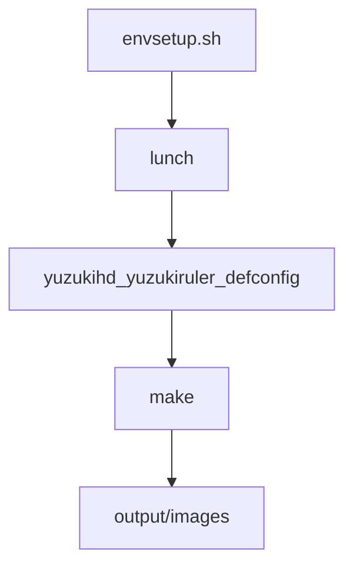

# YuzukiHD/Buildroot-YuzukiSBC

> Paquets Buildroot pour construire un Linux embarqué sur des cartes Allwinner YuzukiHD.

## Le problème
Construire une image Linux pour de petites cartes Allwinner (F1C100s, V3s, D1, T113, H616) exige un environnement de compilation croisée préparé.

## Ce que ça fait vraiment
Adaptation de Buildroot avec des scripts (envsetup.sh, lunch) et des configurations par carte. On choisit une defconfig, puis `make` construit noyau, chargeur d'amorçage et système de fichiers.

## Comment c'est branché
Schéma simplifié d'après la fiche, sans diagramme fourni.


## Essayer
```bash
git clone https://github.com/yuzukihd/Buildroot-YuzukiSBC
cd Buildroot-YuzukiSBC
source envsetup.sh
lunch
make yuzukihd_yuzukiruler_defconfig
make
```

## Coût et pièges
Dépôt archivé, dernier push en 2023. Une compilation Buildroot complète est longue et demande Linux.

## Ce que ce n'est pas
Pas un système prêt à l'emploi ni une distribution maintenue.

## Alternatives
Buildroot lui-même (le README en reprend le texte).

## Pour toi
À ignorer : archivé, matériel embarqué sans lien avec le data/IA.

