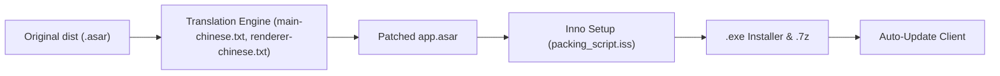

# Z-Siqi/Clash-for-Windows_Chinese

> Unofficial Chinese-translated version of the Clash for Windows proxy client, distributed as a modified installer.

## The problem
Clash for Windows is not available in Chinese; this repository modifies the original package to translate the interface.

## What it actually does
The repository patches the `app.asar` file (renderer.js, main.js) with replacement tables, then packages the result with Inno Setup (.exe installer) or as a 7z archive. The README announces that the installer "hijacks" the update mechanism to deliver the translated versions, and that a third-party link (Clash-for-Windows_Chinese-Attached) is injected. An "Optimize" version with sources is mentioned.

## How it is wired

## Trying it
No command; the README describes downloading an installer or 7z archive from the releases.

## Cost and gotchas
Free. Modified binary, hijacked update, injected third-party link and advertising for a proxy provider in the README. The README says it provides no support for mainland China. No license declared.

## What it is not
It is not the official software: the README asks you to revert to the original before reporting any bug. The README strikes through a November 2023 archiving notice, whereas the catalog indicates not archived.

## Alternatives
- The original Clash for Windows client, cited as the official version.

## For you
Ignore: a tampered executable with a hijacked update is an unnecessary risk, and has no relation to data/AI/MLOps work.
