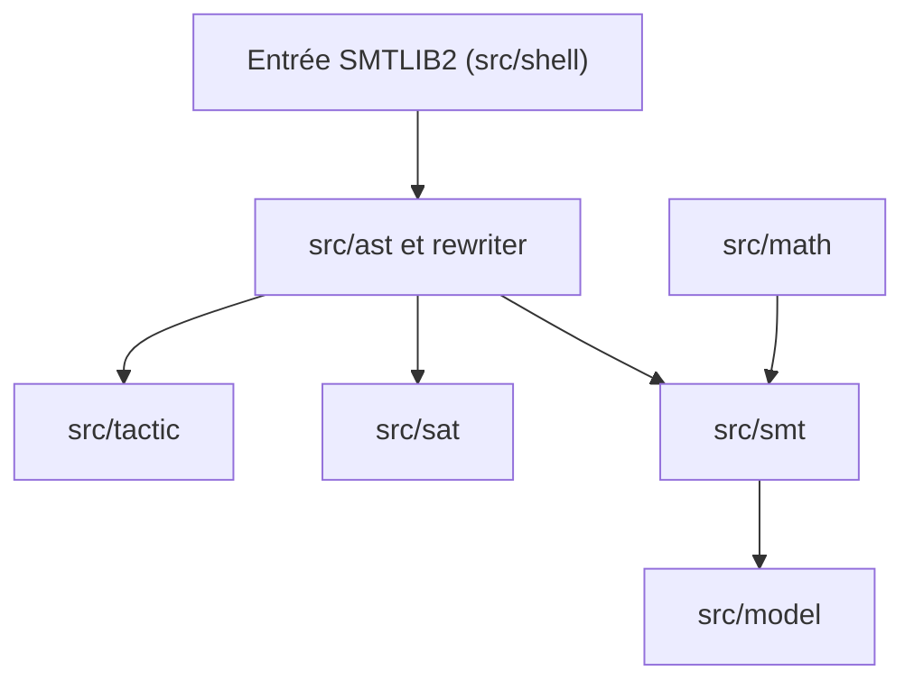

# Z3Prover/z3

> Theorem prover and SMT solver from Microsoft Research, with APIs in many languages.

## The problem
Checking logical constraints, programs or configurations by hand is impractical and error-prone.

## What it actually does
Solves logical formulas (arithmetic, bit-vectors, arrays) read in SMTLIB2 or through the C, C++, .NET, Java, Python, Go, OCaml, Julia, JavaScript and Rust APIs. Offers tactics, optimization and model construction. Installed with `pip install z3-solver`, NuGet, npm or by building from source.

## How it is wired


## Trying it
```bash
pip install z3-solver
cmake -S . -B build -DCMAKE_BUILD_TYPE=Release
cmake --build build --parallel $(nproc)
python -c 'import z3; print(z3.get_version_string())'
```

## Cost and gotchas
Free. Building requires C++20 and Python. The README says MIT but GitHub does not identify the license; to be checked. Bug reports coming from fuzzing without analysis may be closed.

## What it is not
Not a large-scale numerical optimization solver nor a learning tool: it is logic and formal verification.

## Alternatives
No alternative named in the README.

## For you
To adopt as a building block: constraints, configuration verification or planning in pipelines, with a Python API installable in one command.
