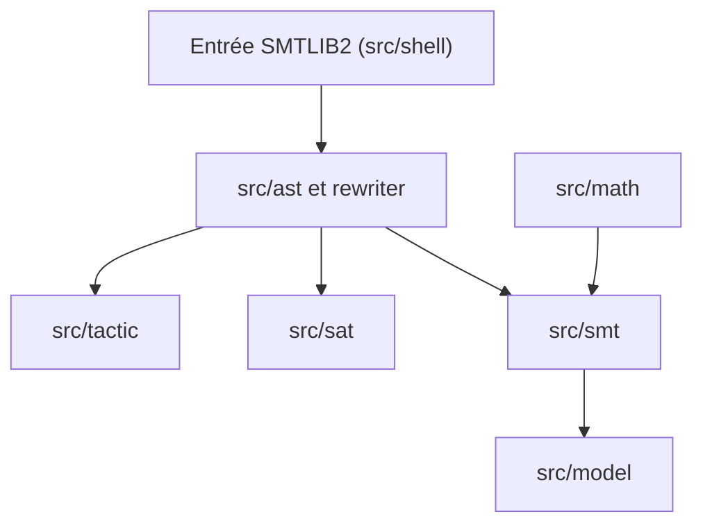

# Z3Prover/z3

> Démonstrateur de théorèmes et solveur SMT de Microsoft Research, avec API dans de nombreux langages.

## Le problème
Vérifier des contraintes logiques, des programmes ou des configurations à la main est impraticable et source d'erreurs.

## Ce que ça fait vraiment
Résout des formules logiques (arithmétique, vecteurs de bits, tableaux) lues en SMTLIB2 ou via les API C, C++, .NET, Java, Python, Go, OCaml, Julia, JavaScript et Rust. Propose des tactiques, de l'optimisation et la construction de modèles. S'installe par `pip install z3-solver`, NuGet, npm ou en compilant.

## Comment c'est branché


## Essayer
```bash
pip install z3-solver
cmake -S . -B build -DCMAKE_BUILD_TYPE=Release
cmake --build build --parallel $(nproc)
python -c 'import z3; print(z3.get_version_string())'
```

## Coût et pièges
Gratuit. La compilation demande C++20 et Python. Le README dit MIT mais GitHub n'identifie pas la licence ; à vérifier. Les rapports de bugs issus de fuzzing sans analyse peuvent être fermés.

## Ce que ce n'est pas
Ce n'est pas un solveur d'optimisation numérique à grande échelle ni un outil d'apprentissage : c'est de la logique et de la vérification formelle.

## Alternatives
Aucune alternative nommée dans le README.

## Pour toi
À adopter comme brique : contraintes, vérification de configurations ou planification dans des pipelines, avec une API Python installable en une commande.

