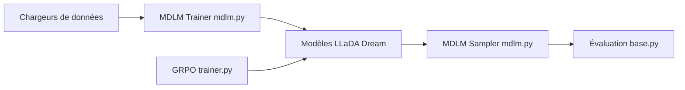

# ZHZisZZ/dllm

> Library for training, inference and evaluation of diffusion language models (LLaDA, Dream).

## The problem
Diffusion language models lack common, reproducible pipelines to train, sample and evaluate them.

## What it actually does
Provides trainers (MDLM, BD3LM) based on the `transformers` Trainer with LoRA, DeepSpeed, FSDP, unified samplers, and an evaluation based on `lm-evaluation-harness`. Examples for LLaDA, Dream, conversion of an autoregressive model (a2d), BERT-Chat, Edit Flows, Fast-dLLM (cache) and GRPO. The README states an educational goal, without exact reproduction of the official models.

## How it is wired


## Trying it
```bash
pip install -e .
accelerate launch --config_file scripts/accelerate_configs/zero2.yaml examples/llada/sft.py --num_train_epochs 4 --load_in_4bit True --lora True
python -u examples/llada/chat.py --model_name_or_path "GSAI-ML/LLaDA-8B-Instruct"
```

## Cost and gotchas
GPU required (installation with CUDA 12.4, PyTorch 2.6.0, conda). Evaluation requires a git submodule. A Slurm script is provided, to be adapted to the cluster's partition.

## What it is not
Not a product: declared educational goal. Text diffusion models are not yet a recognized alternative to autoregressive models in this README.

## Alternatives
No alternative named in the README.

## For you
Worth watching: a good entry point to experiment with language diffusion, but reserved for research until you have a specific need.
