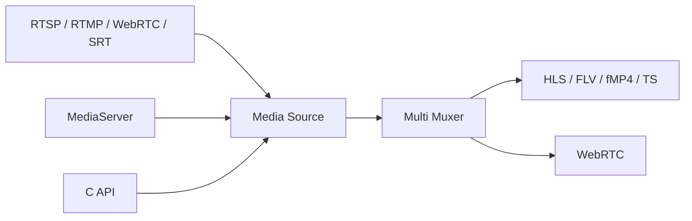

# ZLMediaKit/ZLMediaKit

> C++11 video streaming server and framework: RTSP, RTMP, HLS, WebRTC, GB28181, SRT.

## The problem
Broadcasting and converting video streams between surveillance and live protocols requires a heavy network stack.

## What it actually does
A pipeline core (frames, tracks, sources) onto which each protocol plugs session, player and pusher; a media source is redistributed in several formats (RTSP, RTMP, HLS, HTTP-FLV, TS, fMP4, WebRTC). `MediaServer` server with REST API and webhooks, C SDK, Go bindings, MP4/HLS recording, per-source clusters. The pro version (transcoding, JT1078, IPTV, YOLO inference) is closed source.

## How it is wired


## Trying it
```bash
docker run -id -p 1935:1935 -p 8080:80 -p 8443:443 -p 8554:554 -p 10000:10000 -p 10000:10000/udp -p 8000:8000/udp -p 9000:9000/udp zlmediakit/zlmediakit:master
bash build_docker_images.sh
```

## Cost and gotchas
Open-source code is free; pro options (transcoding, AI) are paid and closed. A license is present but not identified by GitHub; the README states MIT and warns of third-party pieces to replace for commercial use. README in Chinese.

## What it is not
AI inference and transcoding are not in the open version.

## Alternatives
No alternative named in the README.

## For you
Worth a look only for video surveillance or video streams feeding a pipeline; otherwise ignore.
