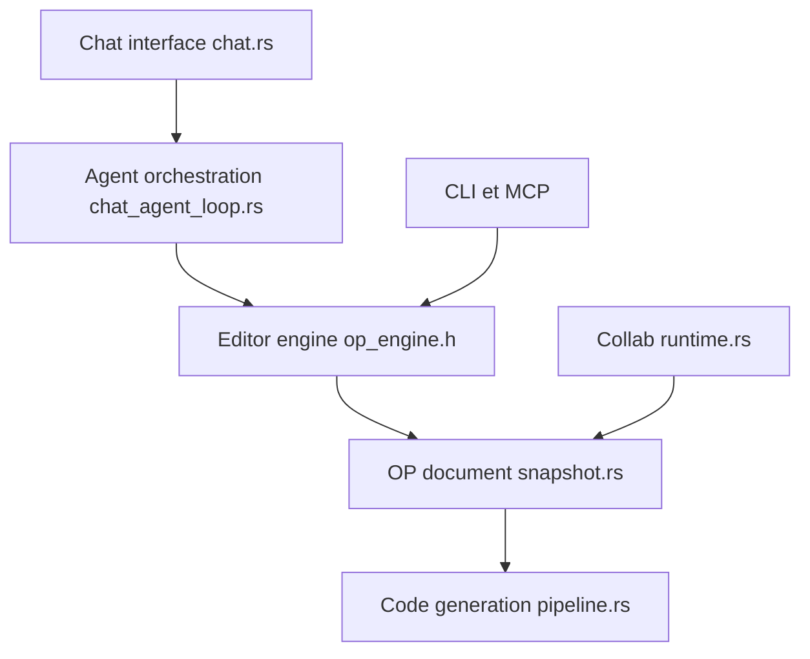

# ZSeven-W/openpencil

> Native Rust vector design tool, driven by AI and MCP, that exports interface code.

## The problem
Going from an interface description to an editable design and then to code forces you to juggle several tools and formats.

## What it actually does
Canvas editor (`.op` files, JSON) where teams of agents generate sections in parallel from a prompt. Built-in MCP server, `op` CLI, export to React+Tailwind, HTML, Vue, Svelte, Flutter, SwiftUI, Compose, Figma `.fig` import, peer-to-peer collaboration, Git integration. Desktop application as a single Rust binary; web version via wasm.

## How it is wired


## Trying it
```bash
brew tap zseven-w/openpencil
brew install --cask openpencil
brew install zseven-w/openpencil/op
```

## Cost and gotchas
You need a model provider key (or a Claude Code/Codex account). The README contains promotional links from API resellers. The Windows installer is sometimes flagged by antivirus software. Building from source: git submodules and Rust.

## What it is not
Not a proven replacement for Figma: the project is evolving fast. The README's "Assessments" section is empty.

## Alternatives
No alternative named in the README.

## For you
Worth watching: interesting for agent-driven interface prototyping, outside the data/MLOps core; wait for it to stabilize.
